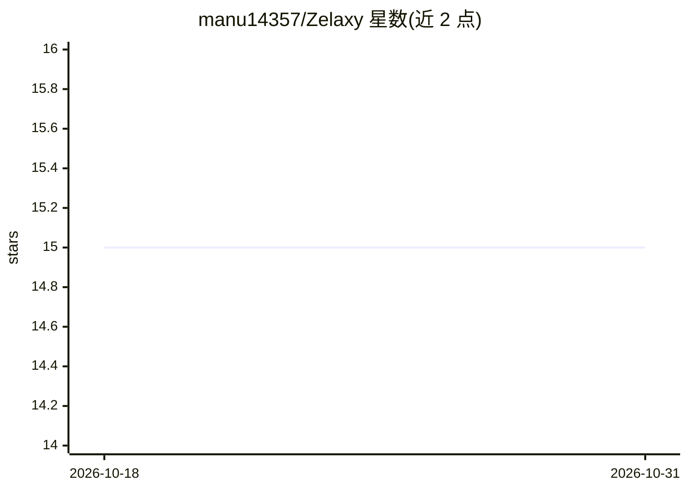

# manu14357/Zelaxy

⭐ 15 · TypeScript · MIT · 推送 2026-07-27 · [GitHub](https://github.com/manu14357/Zelaxy) · [官网](https://zelaxy.in) · 个人维护

**开源可视化 AI agent 与工作流构建平台，自托管、无代码**

基于 Next.js 15/React 19/Bun/PostgreSQL+pgvector 的可视化工作流平台：在画布上拖拽 270+ 种积木（agent、逻辑、循环、子工作流、guardrails），由并发拓扑执行引擎运行并支持逐 token 流式输出。内置 pgvector 向量检索的 RAG、实时多人协作编辑、245+ 集成、65+ 触发器，支持 OpenAI/Anthropic/Ollama/vLLM 等 25+ 模型提供方，另提供 TypeScript/Python SDK 与 CLI。面向不想自写后端即要编排 AI 流程的开发者与团队，需自备 PostgreSQL+pgvector 与至少一个 LLM API key，源码方式自托管，也有托管版 zelaxy.in。

## 筛选速览

| 维度 | 判定 | 备注 |
|---|---|---|
| AI 角色 | `ai-ecosystem` | LLM/agent 周边工具 |
| 许可风险 | `permissive` | MIT |
| 部署形态 | `None` |  |
| 模型依赖 | local-ok | 支持本地模型 |
| 硬件要求 | — | 无带数字的原话,不猜 |
| 安装摩擦 | `low` | 无编译、无系统依赖或容器化 |
| 成熟度 | — | 结构信号不足 |

## 能力要点

- 270+ 积木、245+ 集成、25+ AI 提供方、65+ 触发器
- 并发拓扑 DAG 执行引擎：并行分支、循环、条件路由、子工作流
- 内置 pgvector RAG（语义+混合检索）与 guardrails（PII/幻觉评分/schema 校验）
- WebSocket 实时多人协作与逐 token 流式输出

## 适用场景

- 不写后端即可编排多 LLM 提供方的自动化流程
- 搭建基于自有文档的 RAG 问答流水线
- 通过 Slack/GitHub/Gmail/webhook/cron 触发自动化工作流
- 自托管并扩展私有积木与集成

## 场景标签

`工作流自动化` `RAG` `Agent 框架` · 领域:Agent 开发

## 证据(README 行号)

> L32: **Zelaxy** is a visual operating system for AI work. You compose workflows on a canvas out of
> L36: It looks like a flow builder. Under the hood it's a **concurrent, topological execution engine** with
> L50: Chain frontier labs, blazing-fast inference hosts, your own cloud, and local models — in a single pipeline.

## 星数曲线

2026-10-18 15 → 2026-10-31 15（+0）

---
*卡片 v1 · prompt 1.4 · 生成 2026-10-30 · 置信度 high · 依据 README sha `54ce9efda563` · [字段定义](../../DATASET.md)*
