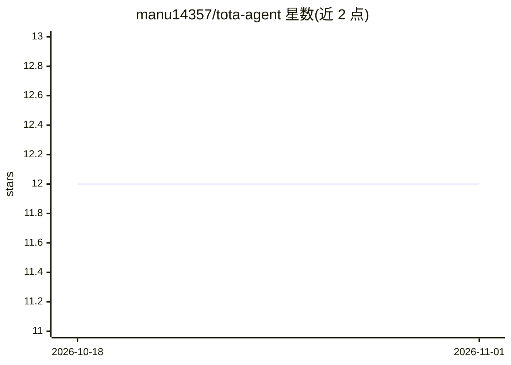

# manu14357/tota-agent

⭐ 12 · TypeScript · MIT · 推送 2026-06-17 · [GitHub](https://github.com/manu14357/tota-agent) · [官网](https://tota-agent.vercel.app/) · 个人维护

**多通道运行的个人 AI agent，带权限控制与持久记忆**

Node.js 实现的命令行 AI agent，通过 12 家 LLM 提供商（OpenAI、Anthropic、DeepSeek、Ollama、Groq 等）驱动。内置 60+ 工具：网页搜索、视觉分析、Playwright 浏览器自动化、computer-use 桌面控制、ADB 安卓控制、代码沙盒、文档读取、MCP 插件。持久化机制包括 SQLite FTS5 的 Second Brain 记忆（10 种记忆类型）与 OS 钥匙串加密的秘密库。访问通道覆盖 CLI、本地 Web UI（127.0.0.1:3001）、Telegram、WhatsApp 与 REST API，支持守护进程与系统服务常驻。安全机制为 Shell 黑名单、目录级作用域与逐会话审批。npm 全局安装，首次运行进入配置向导。

## 筛选速览

| 维度 | 判定 | 备注 |
|---|---|---|
| AI 角色 | `ai-native` | 本体是模型或模型工具 |
| 许可风险 | `permissive` | MIT |
| 部署形态 | `library` | 以包/库形式分发 |
| 模型依赖 | local-ok | 支持本地模型 |
| 硬件要求 | — | 无带数字的原话,不猜 |
| 安装摩擦 | `low` | 无编译、无系统依赖或容器化 |
| 成熟度 | — | 结构信号不足 |

## 能力要点

- 12 家 LLM 提供商接入，含 Ollama 本地运行时
- SQLite FTS5 持久记忆与 10 种记忆类型
- 36 个浏览器自动化工具、computer-use 与 Android ADB 控制
- CLI/Telegram/WhatsApp/REST/本地 Web UI 五通道访问，守护进程常驻

## 适用场景

- 通过 Telegram 或 WhatsApp 随时指挥 AI 代为执行任务
- 让 agent 长期记住个人偏好并按日程自动执行计划任务
- 在本机用浏览器/桌面/安卓自动化完成多步骤工作流

## 场景标签

`AI 助手` `浏览器自动化` `GUI 自动化` `Agent 记忆` · 领域:Agent 开发

## 证据(README 行号)

> L3:  AI agent built for control: permissioned tools, safe execution, token budgets, and multi-channel access.
> L5:  Remembers what matters. Asks before it acts. Runs 24/7 from CLI, Telegram, WhatsApp, REST API, or **local web UI**.
> L6:  60+ built-in tools · Web search · Vision · Code sandbox · Browser automation (36 tools) · Computer-use · Android co

## 星数曲线

2026-10-18 12 → 2026-11-01 12（+0）

---
*卡片 v1 · prompt 1.4 · 生成 2026-11-01 · 置信度 high · 依据 README sha `8a1c0a537cbf` · [字段定义](../../DATASET.md)*
