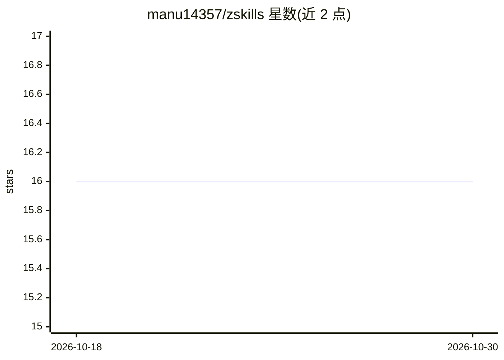

# manu14357/zskills

⭐ 16 · Python · MIT · 推送 2026-07-24 · [GitHub](https://github.com/manu14357/zskills) · [官网](https://zskills.vercel.app) · 个人维护

**面向 AI agent 的 SKILL.md 技能注册表：发现、安装、贡献技能**

GitHub 原生的 agent 技能注册平台：技能以 SKILL.md 文件存于仓库 skills/ 目录，无独立数据库，贡献通过 GitHub PR 完成，CI 自动校验并合并。提供 Next.js 15 网站浏览/搜索/提交/fork 技能，以及 zskills CLI（npm 安装）按目录、agent 安装技能到本地或 agent 专属路径。SKILL.md 标准要求 name 与 description 字段，可选 category/agents/author。当前为 MVP 状态，可自部署到 Vercel 并指向自有仓库。

## 筛选速览

| 维度 | 判定 | 备注 |
|---|---|---|
| AI 角色 | `ai-ecosystem` | LLM/agent 周边工具 |
| 许可风险 | `permissive` | MIT |
| 部署形态 | `library` | 以包/库形式分发 |
| 模型依赖 | — | README 未给出锁定关系 |
| 硬件要求 | — | 无带数字的原话,不猜 |
| 安装摩擦 | `low` | 无编译、无系统依赖或容器化 |
| 成熟度 | — | 结构信号不足 |

## 能力要点

- 无数据库、无登录，技能以 SKILL.md 形式存于仓库，PR 为唯一写入路径
- zskills CLI 支持按名称/agent/全局路径安装与列出技能
- GitHub Actions 自动校验 frontmatter 并自动合并合格 PR
- 网站提供搜索、分类浏览、贡献者排行与历史版本对比

## 适用场景

- 为自己的 AI agent 查找并安装现成技能
- 通过 PR 向注册表提交或修改技能
- 基于该仓库自建一套私有技能注册表

## 场景标签

`精选清单` `提示工程` · 领域:Agent 开发

## 证据(README 行号)

> L3: The open registry for agent skills - built by everyone, for every agent.
> L5: ZSkills is a no-login, GitHub-native platform for `SKILL.md` files. Every skill is stored in this repository under `

## 星数曲线

2026-10-18 16 → 2026-10-30 16（+0）

---
*卡片 v1 · prompt 1.4 · 生成 2026-10-30 · 置信度 high · 依据 README sha `03823f49704a` · [字段定义](../../DATASET.md)*
