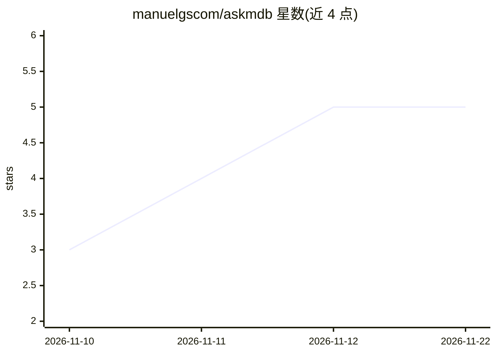

# manuelgscom/askmdb

⭐ 5 · C++ · MIT · 推送 2026-10-29 · [GitHub](https://github.com/manuelgscom/askmdb) · [官网](https://manuelgs.com/en/askmdb/) · 个人维护

**自然语言查询 MongoDB 的离线 CLI 工具**

单一原生二进制，内置为该任务微调的小模型（经 llama.cpp）与 C++ 确定性只读校验器：将英/西语问题转成 MongoDB aggregate 管道，先采样集合 schema 注入提示，校验器按允许清单将管道分为 read only/warning/blocked 三级，仅确认后执行，输出表格或 JSON。要求 AVX2 CPU 与 glibc 2.29+，MongoDB 5.0+，可选 4 GiB VRAM 独显走 Vulkan；仅支持 Linux x86_64（Windows 经 WSL 2）。

## 筛选速览

| 维度 | 判定 | 备注 |
|---|---|---|
| AI 角色 | `ai-native` | 本体是模型或模型工具 |
| 许可风险 | `permissive` | MIT |
| 部署形态 | `self-host` | docker 或自建部署 |
| 模型依赖 | local-ok | 支持本地模型 |
| 硬件要求 | `cpu-ok` | |
| 安装摩擦 | `low` | 无编译、无系统依赖或容器化 |
| 成熟度 | — | 结构信号不足 |

## 能力要点

- 微调小模型 + 确定性校验器，代码而非模型判定只读安全
- 三级校验（read only/warning/blocked），blocked 永不执行，仅运行 aggregate 且带时限与行数上限
- CPU/GPU（Vulkan）同一二进制，无账号、API key 与遥测
- 支持英/西语提问与相对日期解析（$$NOW）

## 适用场景

- 不写 aggregate 语法也能查询自己的 MongoDB
- 离线环境下安全地把自然语言转成只读查询
- 给运维脚本提供 --json 的确定性查询出口

## 场景标签

`数据分析` · 领域:效率与自动化

## 证据(README 行号)

> L16: `askmdb` turns a question in **English or Spanish** into a MongoDB `aggregate` pipeline. It explains the pipeline, 
> L26: - **Read-only, decided by code, not by the model.** A deterministic verifier written in C++ walks the whole pipelin
> L30: - **Only `aggregate`, always with limits.** It is the only MongoDB operation in the code. Every run has a server ti

## 星数曲线

2026-11-10 3 → 2026-11-22 5（+2）

---
*卡片 v1 · prompt 1.4 · 生成 2026-11-21 · 置信度 mid · 依据 README sha `ffaedf9e94e3` · [字段定义](../../DATASET.md)*
