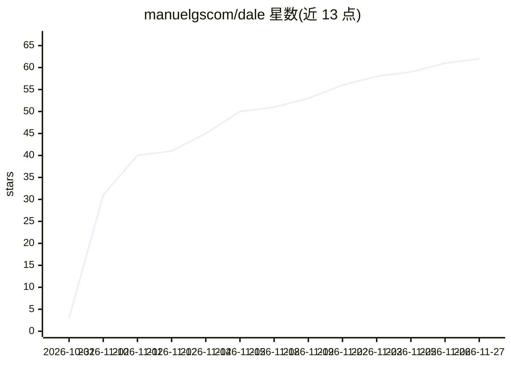

# manuelgscom/dale

⭐ 62 · C++ · MIT · 推送 2026-10-29 · [GitHub](https://github.com/manuelgscom/dale) · [官网](https://manuelgs.com/en/dale/) · 个人维护

**离线自然语言转 Linux 命令的原生 CLI 二进制**

dale 把英文或西班牙语请求转换成一条 bash 命令：内置专为该任务微调的模型（Qwen3.5-0.8B/4B/9B 的 Q4_K_M 微调版），llama.cpp 链接进单个 C++ 原生二进制，CPU 默认、Vulkan 支持 GPU，全程无网络、无账号、无 API key。生成后由确定性 C++ 风险校验器评为 safe/caution/danger，危险命令需输入确认词，并支持 suggest/confirm/auto 三种模式。提供约 51 MB 预编译二进制，要求 Linux x86_64 + AVX2 + glibc ≥ 2.29，也可从源码用 CMake 构建。面向 Linux 桌面/命令行用户。

## 筛选速览

| 维度 | 判定 | 备注 |
|---|---|---|
| AI 角色 | `ai-native` | 本体是模型或模型工具 |
| 许可风险 | `permissive` | MIT |
| 部署形态 | `None` |  |
| 模型依赖 | local-ok | 支持本地模型 |
| 硬件要求 | — | 无带数字的原话,不猜 |
| 安装摩擦 | `high` | 编译与系统依赖俱全 |
| 成熟度 | — | 结构信号不足 |

## 能力要点

- 单一原生二进制内置 llama.cpp 推理，100% 离线运行
- 确定性 C++ 风险校验器独立于模型为命令分级，危险命令需键入确认词
- 感知系统上下文（发行版、包管理器、PATH 中已装工具）
- 三档模型（0.8B/4B/9B）按 GPU 显存自动选择，支持 --model 指定 GGUF

## 适用场景

- 用自然语言生成并执行 Linux 命令，不依赖云服务
- 不熟悉 shell 语法的用户安全地完成文件查找、批量操作等任务
- 在离线或隐私敏感环境中使用本地 LLM 命令助手

## 场景标签

`代码生成` · 领域:编码与开发

## 证据(README 行号)

> L16: `dale` turns a request in **English or Spanish** into one bash command. It explains the command, rates its risk and
> L157: 2. **Inference engine.** llama.cpp is linked into the binary through `llama.h`, with no server, daemon or port. It

## 星数曲线

2026-10-31 3 → 2026-11-27 62（+59）

---
*卡片 v1 · prompt 1.4 · 生成 2026-11-18 · 置信度 high · 依据 README sha `afedbf3b9a1e` · [字段定义](../../DATASET.md)*
