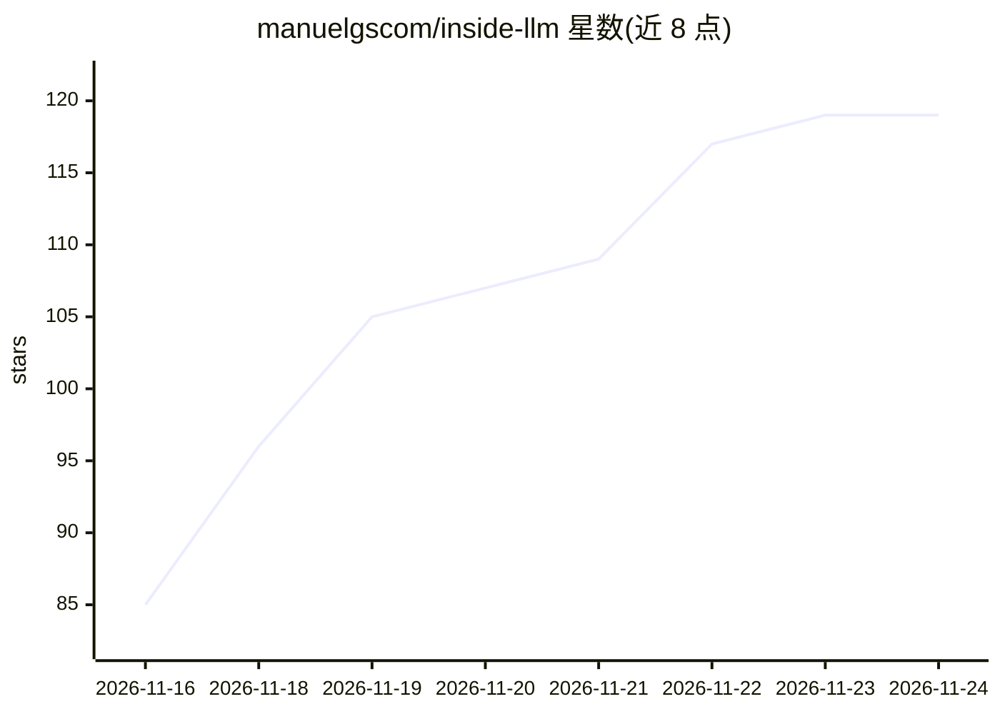

# manuelgscom/inside-llm

⭐ 120 · TypeScript · MIT · 推送 2026-11-22 · [GitHub](https://github.com/manuelgscom/inside-llm) · [官网](https://manuelgs.com/en/inside-llm/) · 个人维护

**浏览器中逐 token 观察两个 GGUF 量化模型分歧的可视化工具**

基于 llama.cpp 的单二进制本地应用：加载一个或两个 GGUF 模型（如同一模型的两种量化、基座与微调版），在浏览器中展示生成过程每个 token 的概率、被丢弃的候选、采样器链各阶段淘汰情况，以及双模型在每一步的熵、JS/KL 散度与文本分裂点，支持分支树、3D 概率面与 logit lens。全部在本机运行，无需账号或 API key。限制：双模型须共享 tokenizer、须同时放入 GPU 显存、仅文本、单 GPU、监听 localhost 无鉴权。提供 Linux/Windows 二进制包与在线回放 demo。

## 筛选速览

| 维度 | 判定 | 备注 |
|---|---|---|
| AI 角色 | `ai-ecosystem` | LLM/agent 周边工具 |
| 许可风险 | `permissive` | MIT |
| 部署形态 | `desktop` | 安装包/桌面程序 |
| 模型依赖 | local-ok | 支持本地模型 |
| 硬件要求 | — | 无带数字的原话,不猜 |
| 安装摩擦 | `high` | 编译与系统依赖俱全 |
| 成熟度 | — | 结构信号不足 |

## 能力要点

- 双模型逐步对比：熵、Jensen-Shannon/KL 散度与文本分裂 token 定位
- 采样器链各阶段（penalties/top-k/top-p/min-p/温度/GBNF）逐级候选存活可视化
- 分支树与精确状态快照，可跳回任意节点；--lens 提供 logit lens 层级预测
- 模型选择器可搜索 Hugging Face 下载 GGUF，会话可录制为静态页回放（无需引擎与 GPU）

## 适用场景

- 对比同一模型两种量化在哪个 token 开始分道扬镳
- 观察 top-k/top-p 等采样参数实际砍掉了哪些候选
- 录制生成会话供他人离线回放复盘

## 场景标签

`模型量化` · 领域:训练与推理

## 证据(README 行号)

> L11: `inside-llm` loads one or two GGUF models with llama.cpp and shows in the browser what the model does while it gene
> L21: - **Gates:** the sampler chain of that decision (penalties, top-k, top-p, min-p, temperature and a GBNF grammar), w
> L24: - **Relief 3D and Layers:** a surface whose height is a probability: the candidates at each position or, with `--le

## 星数曲线

2026-11-16 85 → 2026-11-24 119（+34）

---
*卡片 v1 · prompt 1.4 · 生成 2026-11-18 · 置信度 high · 依据 README sha `90288dccdec9` · [字段定义](../../DATASET.md)*
