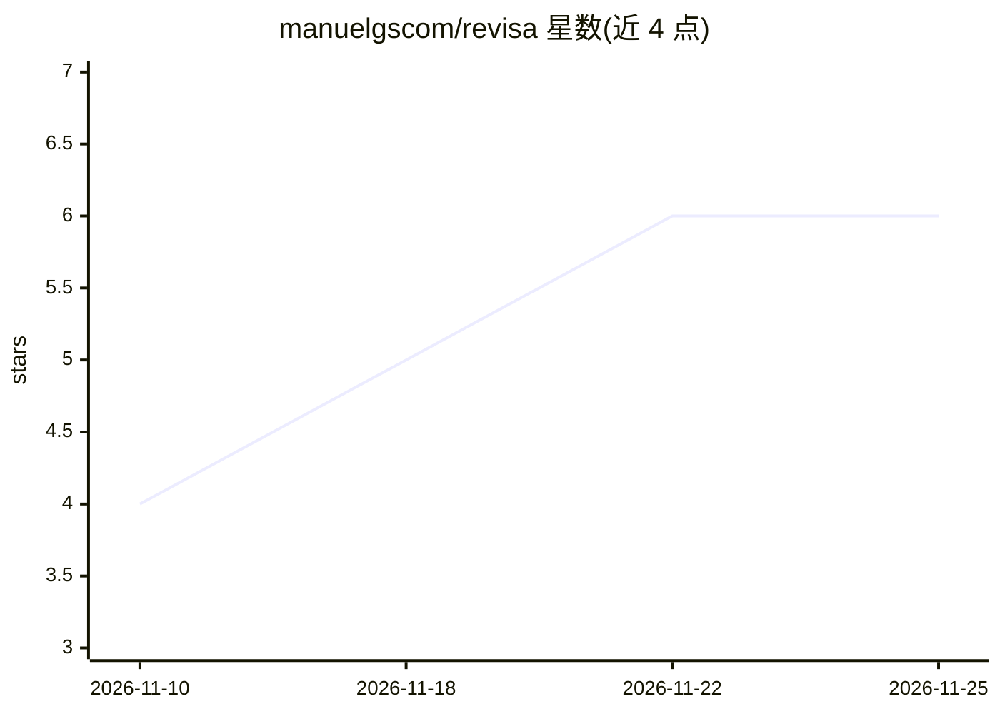

# manuelgscom/revisa

⭐ 6 · C++ · MIT · 推送 2026-11-08 · [GitHub](https://github.com/manuelgscom/revisa) · [官网](https://manuelgs.com/en/revisa/) · 个人维护

**给西语写作者的离线全文校对器：选中文字按快捷键即获修正**

以托盘应用形式运行的西班牙语校对工具：在任何应用中选中文本、按 Ctrl+Alt+Space，弹出窗口逐条显示修改及解释，Enter 即替换原选区。内置 0.8B 微调模型（GGUF），通过 llama.cpp 风格的 C++ 引擎在 CPU 上以投机解码运行，约 138 ms/句；31 类预定义错误目录 + 确定性守卫过滤改写类改动，保护 URL、代码、@提及等非正文文本。模型仅首次下载 529 MB（SHA-256 校验），此后 100% 离线、无遥测。另提供 CLI（revisa check）、本地 HTTP 服务与 LSP。Windows 安装包 + Linux AppImage/静态 CLI 分发。

## 筛选速览

| 维度 | 判定 | 备注 |
|---|---|---|
| AI 角色 | `ai-native` | 本体是模型或模型工具 |
| 许可风险 | `permissive` | MIT |
| 部署形态 | `desktop` | 安装包/桌面程序 |
| 模型依赖 | local-ok | 支持本地模型 |
| 硬件要求 | `cpu-ok` | |
| 安装摩擦 | `medium` | 含编译或系统依赖之一 |
| 成熟度 | — | 结构信号不足 |

## 能力要点

- 任意应用中选中文本按快捷键校对，含终端；无需插件集成
- 0.8B 微调模型 CPU 推理，投机解码中位 138 ms/句
- 31 类固定错误目录与确定性守卫，仅改正字规则不改风格
- 纯本地运行：无遥测，仅首次一次性模型下载并 SHA-256 校验

## 适用场景

- 写邮件或聊天时快速修正西语拼写、重音与同音词错误
- 在 Git 提交信息、Markdown 编辑器中通过 CLI 或 LSP 校对文本
- 脚本与 CI 中用 revisa check 的退出码驱动校对流程

## 场景标签

`AI 写作` · 领域:内容生成

## 证据(README 行号)

> L15: Cloud proofreaders send what you write to someone else's server. The local, rule-based ones struggle with real mist
> L29: - **For your tools too:** a CLI (`revisa check`), a local HTTP server (`revisa serve`) and a language server for Ma

## 星数曲线

2026-11-10 4 → 2026-11-25 6（+2）

---
*卡片 v1 · prompt 1.4 · 生成 2026-11-21 · 置信度 high · 依据 README sha `39f3f308a580` · [字段定义](../../DATASET.md)*
