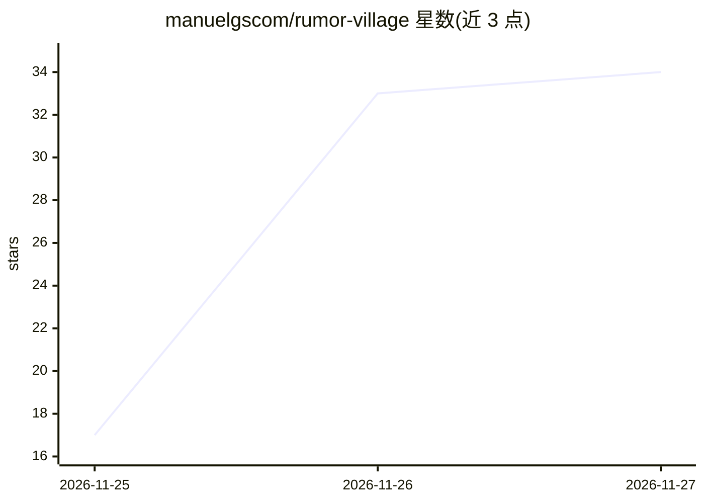

# manuelgscom/rumor-village

⭐ 34 · JavaScript · MIT · 推送 2026-11-22 · [GitHub](https://github.com/manuelgscom/rumor-village) · [官网](https://manuelgs.com/en/rumor-village/) · 个人维护 · 中文 README

**用本地微调 LLM 驱动 100 个村民的谣言传播模拟游戏**

3D 村庄模拟游戏：玩家投放一条谣言，观察其在最多 100 个邻居之间口口相传并被扭曲。With AI 模式下每个邻居由针对本游戏微调的 Gemma 4 E4B（Q4_K_M）驱动，通过内嵌于 C++ 引擎的 llama.cpp 批量循环推理，模型只提议动作、引擎负责验证，同种子可精确复现；Without AI 模式用骰子规则、无需显卡。离线运行、无账号，提供 Windows zip 与 Linux AppImage 预编译包，也可用 Docker 从源码构建。微调训练管线不在本仓库内。

## 筛选速览

| 维度 | 判定 | 备注 |
|---|---|---|
| AI 角色 | `ai-native` | 本体是模型或模型工具 |
| 许可风险 | `permissive` | MIT |
| 部署形态 | `desktop` | 安装包/桌面程序 |
| 模型依赖 | local-ok | 支持本地模型 |
| 硬件要求 | — | 无带数字的原话,不猜 |
| 安装摩擦 | `medium` | 含编译或系统依赖之一 |
| 成熟度 | — | 结构信号不足 |

## 能力要点

- 微调模型将每决策提示从 921 token 压缩到 256 token 卡片
- 100 个邻居单 GPU 一批次批量决策，支持 CUDA 与 Vulkan
- 模型提议、引擎验证的强制 JSON 动作结构
- 附 1,000 决策冻结测试对比基座与微调模型

## 适用场景

- 观察谣言在村庄人际网络中的传播与变形过程
- 消费级显卡上离线玩本地 LLM 驱动的模拟游戏
- 用好友挑战码与朋友共享同一村庄同一谣言对局

## 场景标签

`多智能体` · 领域:Agent 开发

## 证据(README 行号)

> L3: **A rumor simulation game with an AI trained for it.** Drop a rumor into a 3D village of up to 100 neighbors and wat
> L52: - **With AI:** the fine-tuned model decides what every neighbor does and says. You can type the rumor in your own w
> L74: - **Every decision goes through the model**, in one batched loop of llama.cpp embedded in a C++ engine with integer

## 星数曲线

2026-11-25 17 → 2026-11-27 34（+17）

---
*卡片 v1 · prompt 1.4 · 生成 2026-11-24 · 置信度 high · 依据 README sha `001b29500615` · [字段定义](../../DATASET.md)*
