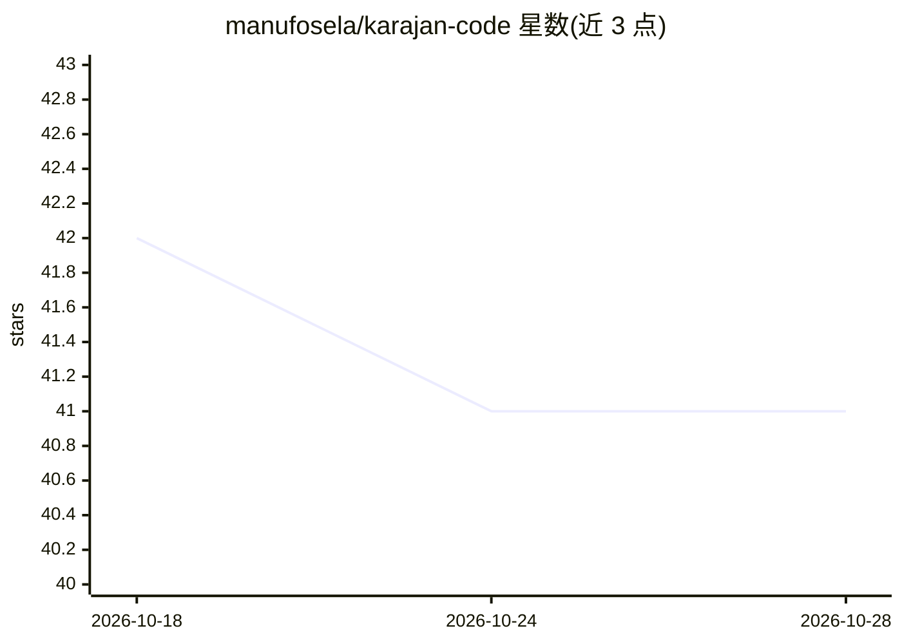

# manufosela/karajan-code

⭐ 41 · JavaScript · AGPL-3.0 · 推送 2026-10-27 · [GitHub](https://github.com/manufosela/karajan-code) · [官网](https://karajancode.com) · 个人维护

**为 AI 编程代理加装治理层的 CLI：TDD 方法、跨 AI 评审与 git 门禁**

面向使用 Claude Code、Codex、Copilot 等 AI 代理写代码的开发者，Karajan Code 安装一套代理须遵循的开发方法并用 git 钩子强制执行：先写失败测试、卡片先行、分支隔离；pre-commit 门禁要求另一个 AI 的评审结论绑定到 diff 的 sha256 才放行提交，第三 AI 仲裁分歧；Sentinel 钩子在 Claude Code 宿主上可在回合内阻断违规，其他宿主仍保持 git 门禁级别。另含本地 RAG 查询（Ollama 或内置 ONNX 嵌入）、隐私扫描、策略三层执行与 headless 多代理流水线。要求 git 和至少一个 AI 代理 CLI。

## 筛选速览

| 维度 | 判定 | 备注 |
|---|---|---|
| AI 角色 | `ai-ecosystem` | LLM/agent 周边工具 |
| 许可风险 | `viral` | AGPL-3.0 |
| 部署形态 | `library` | 以包/库形式分发 |
| 模型依赖 | local-ok | 支持本地模型 |
| 硬件要求 | — | 无带数字的原话,不猜 |
| 安装摩擦 | `low` | 无编译、无系统依赖或容器化 |
| 成熟度 | — | 结构信号不足 |

## 能力要点

- 跨 AI 评审绑定 diff sha256，无批准结论则提交被 pre-commit 拒绝
- Sentinel 确定性钩子（零 LLM）阻断代理在违规未清时结束回合（限 Claude Code 宿主）
- 本地 RAG：Ollama 或内置 ONNX 嵌入器，云端嵌入需敏感声明并 PII 脱敏
- 九个内置评审代理，配额耗尽时带提示切换候选

## 适用场景

- 让 AI 代理写代码时强制执行 TDD 与跨 AI 评审流程
- 在 CI 中无人值守运行多代理流水线并阻止违规 diff 进入主干
- 对 AI 产出的提交做隐私与安全门禁（密钥、个人数据拦截）

## 场景标签

`代码审查` `RAG` · 领域:编码与开发

## 证据(README 行号)

> L15: Your AI agent (Claude Code, Codex, Copilot, Antigravity, Cursor…) writes the code. **Karajan governs how it happens
> L20: - **Deterministic first, then cross-AI review** — `kj review --staged` runs SonarQube on the changed files before a
> L25: - **Installing IS activating** — `kj env install` performs the enforcement itself (git hooks, verdict gate, tool ga

## 星数曲线

2026-10-18 42 → 2026-10-28 41（-1）

---
*卡片 v1 · prompt 1.4 · 生成 2026-10-25 · 置信度 high · 依据 README sha `cdb4ac52049e` · [字段定义](../../DATASET.md)*
