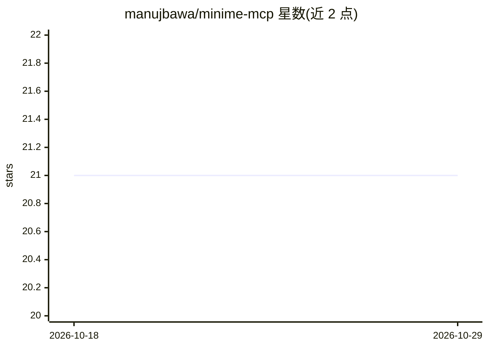

# manujbawa/minime-mcp

⭐ 21 · JavaScript · NOASSERTION · 推送 2026-02-11 · [GitHub](https://github.com/manujbawa/minime-mcp) · [官网](https://recallium.ai) · 个人维护

**已更名为 Recallium 的开发者 AI 助手通用记忆层**

原 MiniMe-MCP 项目，现已更名为 Recallium 并迁移至新仓库 recallium-ai/recallium。本项目定位为面向开发者 AI 助手的通用无限记忆层：在 Claude、Cursor、Windsurf 等多个助手间共享同一记忆，基于 MCP 标准构建并完全本地运行，避免重复解释上下文。当前 README 仅保留迁移公告，指向新仓库、安装指南（覆盖各 IDE 配置）与 Docker Hub 官方镜像，未包含具体安装命令或功能细节。

## 筛选速览

| 维度 | 判定 | 备注 |
|---|---|---|
| AI 角色 | `ai-ecosystem` | LLM/agent 周边工具 |
| 许可风险 | `none` | NOASSERTION |
| 部署形态 | `None` |  |
| 模型依赖 | — | README 未给出锁定关系 |
| 硬件要求 | — | 无带数字的原话,不猜 |
| 安装摩擦 | `low` | 无编译、无系统依赖或容器化 |
| 成熟度 | — | 结构信号不足 |

## 能力要点

- 基于 MCP 标准的记忆层，支持 Claude/Cursor/Windsurf 等多个 AI 助手共享记忆
- 完全本地运行
- 提供 Docker Hub 官方镜像

## 适用场景

- 让多个 IDE 内的 AI 助手共享同一份项目记忆
- 跨会话保留上下文，避免重复解释项目背景

## 场景标签

`Agent 记忆` · 领域:Agent 开发

## 证据(README 行号)

> L3: # MiniMe is now Recallium
> L5: MiniMe-MCP has been rebranded to **Recallium**. The project has moved to a new home.

## 星数曲线

2026-10-18 21 → 2026-10-29 21（+0）

---
*卡片 v1 · prompt 1.4 · 生成 2026-10-28 · 置信度 low · 依据 README sha `ec35b667888a` · [字段定义](../../DATASET.md)*
