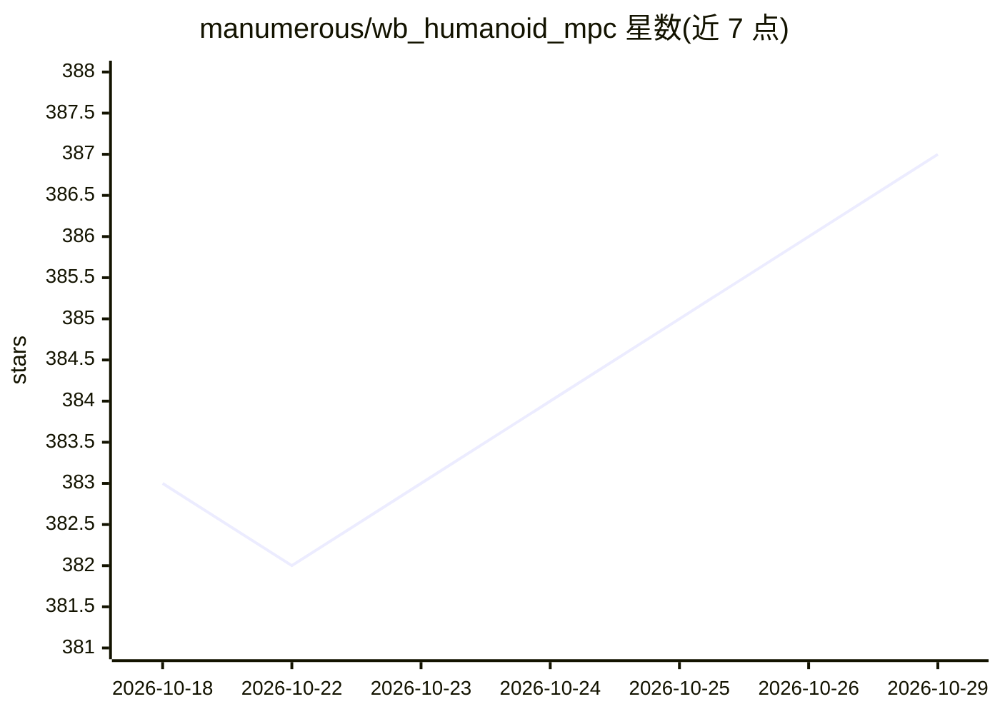

# manumerous/wb_humanoid_mpc

⭐ 387 · C++ · BSD-3-Clause · 推送 2026-10-18 · [GitHub](https://github.com/manumerous/wb_humanoid_mpc) · 个人维护

**人形机器人全身非线性 MPC 规划与控制框架**

基于扩展版 ocs2 的人形机器人全身非线性模型预测控制（NMPC）框架，实时优化全阶力矩级动力学，生成 loco-manipulation 行为。提供质心动力学 MPC 与全身动力学 MPC 两种硬件无关的 formulation，支持 Unitree G1 示例（1X Neo 标注即将支持）。通过 colcon 工作区从源码构建，支持 Docker 化开发环境或本地 ROS2 安装；运行示例经 make 命令启动，首次运行需生成自动微分代码（约 5-15 分钟），可用 Xbox 手柄或 GUI 交互控制。构建对内存要求较高（默认 16 GiB）。

## 筛选速览

| 维度 | 判定 | 备注 |
|---|---|---|
| AI 角色 | `ai-native` | 本体是模型或模型工具 |
| 许可风险 | `permissive` | BSD-3-Clause |
| 部署形态 | `self-host` | docker 或自建部署 |
| 模型依赖 | — | README 未给出锁定关系 |
| 硬件要求 | — | 无带数字的原话,不猜 |
| 安装摩擦 | `low` | 无编译、无系统依赖或容器化 |
| 成熟度 | `idea` | |

## 能力要点

- 实时优化全阶力矩级动力学的全身 NMPC
- 质心动力学与全身动力学两种 MPC formulation
- Unitree G1 示例与 Rviz 可视化
- 提供 Docker 化工作区与本地 ROS2 两种安装路径

## 适用场景

- 人形机器人步态与操作的实时规划控制研究
- 在仿真中通过手柄交互调试全身 MPC 行为
- 作为基础框架开发其他人形机器人平台的控制器

## 场景标签

 · 领域:机器人学/运动控制

## 证据(README 行号)

> L3: This repository contains a Whole-Body Nonlinear Model Predictive Controller (NMPC) for humanoid loco-manipulation co
> L9: It contains the following hardware platform agnostic MPC fromulations:

## 星数曲线

2026-10-18 383 → 2026-10-29 387（+4）

---
*卡片 v1 · prompt 1.4 · 生成 2026-10-21 · 置信度 high · 依据 README sha `d2b14b102a68` · [字段定义](../../DATASET.md)*
