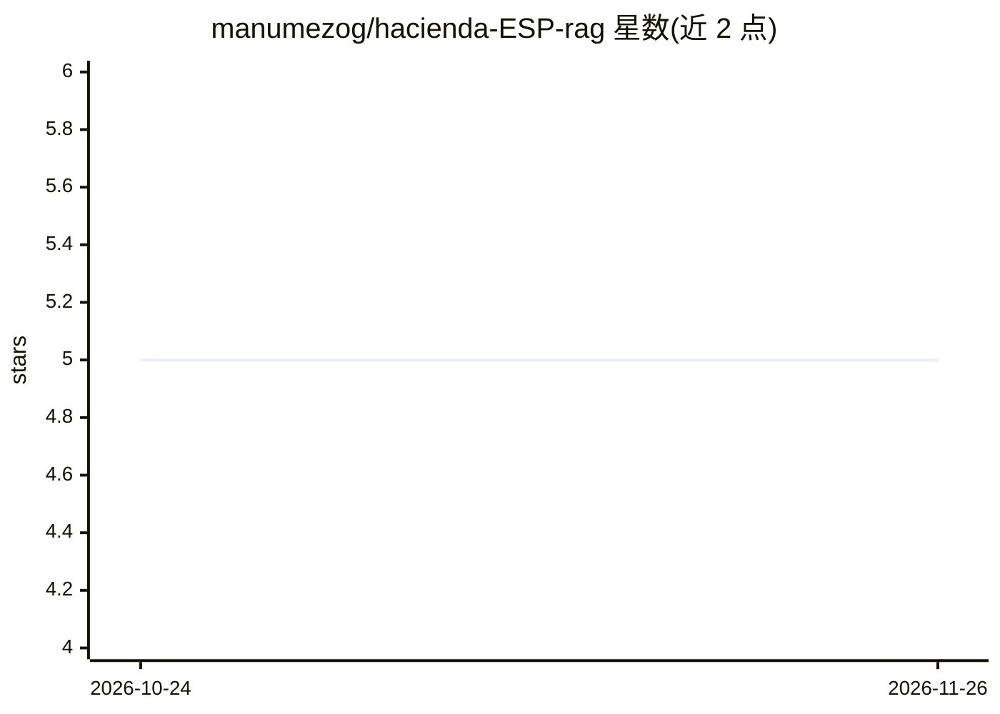

# manumezog/hacienda-ESP-rag

⭐ 5 · TypeScript · 推送 2026-10-18 · [GitHub](https://github.com/manumezog/hacienda-ESP-rag) · [官网](https://hacienda-esp-rag.vercel.app) · 个人维护

**面向法律/财税场景的 RAG 基准：MRL 压缩向量+本地文本回填**

基于 36,053 条西班牙税收裁定（2016–2026，1.05 GB）的生产型 Legal RAG 与 Matryoshka 表示学习（MRL）基准。三步流水线：Top-10 语义检索、本地 SQLite 只读回填全文（<2ms）、Gemini 生成的双语（西/英）结构化法律意见并附可点击官方引用。通过动态前缀切片（768D→128D/256D/512D）+L2 重归一化，在不重建索引的前提下降低向量数据库 RAM（最高 -83.3%），云端仅存向量不存文本。边缘侧运行于 NVIDIA Jetson Orin Nano，经 Cloudflare Tunnel 暴露 API，内置 IP 限流与提示注入隔离。README 未提供安装步骤。

## 筛选速览

| 维度 | 判定 | 备注 |
|---|---|---|
| AI 角色 | `ai-native` | 本体是模型或模型工具 |
| 许可风险 | `none` | — |
| 部署形态 | `None` |  |
| 模型依赖 | local-ok | 支持本地模型 |
| 硬件要求 | — | 无带数字的原话,不猜 |
| 安装摩擦 | `low` | 无编译、无系统依赖或容器化 |
| 成熟度 | — | 结构信号不足 |

## 能力要点

- Matryoshka 动态切片（vector[:d]）+L2 重归一化，免重建索引切换维度
- 云端仅存 halfvec 向量（约 276 MB），全文由本地 SQLite 只读回填
- 双滑窗 IP 限流（10 次/分、200 次/天）与 XML 结构隔离防提示注入
- 提供实时 Side-by-Side 基准对比 768D 与各切片维度的检索结果

## 适用场景

- 查询西班牙税收裁定的法律依据并核对官方原文
- 评估不同向量维度下检索质量与内存占用的权衡
- 参考边云混合架构在低配额云服务上部署 RAG

## 场景标签

`RAG` · 领域:知识与检索

## 证据(README 行号)

> L11: > **An open-source production Legal RAG & Matryoshka Representation Learning (MRL) benchmark by Manuel Mezo**
> L34: 1. **Semantic Retrieval (`Top-K = 10`):** Embeds the user's tax scenario on GPU and retrieves the **10 most relevan
> L36: 3. **Bilingual Grounded Synthesis (ES / EN):** **Gemini 3.8 Flash** synthesizes a structured legal opinion (in **Sp

## 星数曲线

2026-10-24 5 → 2026-11-26 5（+0）

---
*卡片 v1 · prompt 1.4 · 生成 2026-11-21 · 置信度 high · 依据 README sha `b4b21b657d1e` · [字段定义](../../DATASET.md)*
