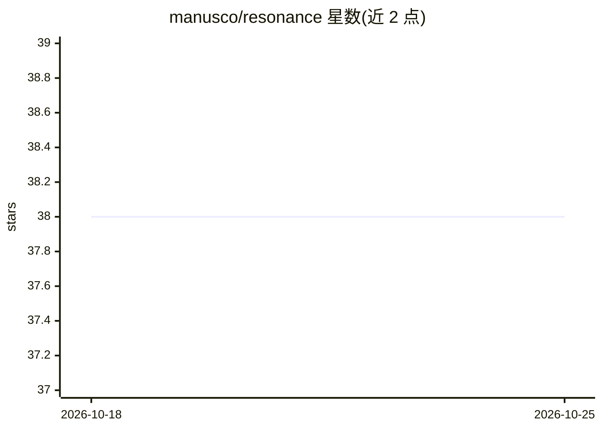

# manusco/resonance

⭐ 38 · Python · MIT · 推送 2026-10-22 · [GitHub](https://github.com/manusco/resonance) · 个人维护

**跨工具 AI agent 技能库：为编码 agent 提供 73 技能与 38 命令**

面向开发者的 AI agent 技能库：收录 73 个覆盖策略、设计、工程、营销、销售、运营等 12 个领域的结构化技能（含前提、步骤算法、Recovery 路径与 Definition of Done），以及 38 个斜杠命令（如 /plan、/grill、/build、/ship）。一份源码经 Forge 编译为 Claude Code、Cursor、Codex、opencode、Antigravity 各自的原生命令格式，并附带会话级项目记忆（.resonance/）。安装方式为 git clone 后直接在工具中打开，无需插件。

## 筛选速览

| 维度 | 判定 | 备注 |
|---|---|---|
| AI 角色 | `ai-ecosystem` | LLM/agent 周边工具 |
| 许可风险 | `permissive` | MIT |
| 部署形态 | `None` |  |
| 模型依赖 | — | README 未给出锁定关系 |
| 硬件要求 | — | 无带数字的原话,不猜 |
| 安装摩擦 | `low` | 无编译、无系统依赖或容器化 |
| 成熟度 | — | 结构信号不足 |

## 能力要点

- 73 个领域技能 + 38 个斜杠命令，单一源码多工具编译
- Forge 生成各工具命令 shim 与上下文桥接（CLAUDE.md/AGENTS.md）
- 会话加载并回写的项目记忆 .resonance/
- 共享操作标准只在 AGENTS.md 声明一次以控制上下文开销

## 适用场景

- 让编码 agent 按固定专家协议执行规划、构建、审计、发布流程
- 在不同 agent 工具间复用同一套技能与命令
- 为项目建立跨会话的架构与决策记忆

## 场景标签

`提示工程` · 领域:Agent 开发

## 证据(README 行号)

> L23: - **Cross-tool by design.** One source compiles to the native format of every major agent tool. The `SKILL.md` / `A
> L39: The command shims are generated from one source (`.forge/commands.json`) by the Forge, which also emits the per-too

## 星数曲线

2026-10-18 38 → 2026-10-25 38（+0）

---
*卡片 v1 · prompt 1.4 · 生成 2026-10-25 · 置信度 high · 依据 README sha `874c116ecc45` · [字段定义](../../DATASET.md)*
