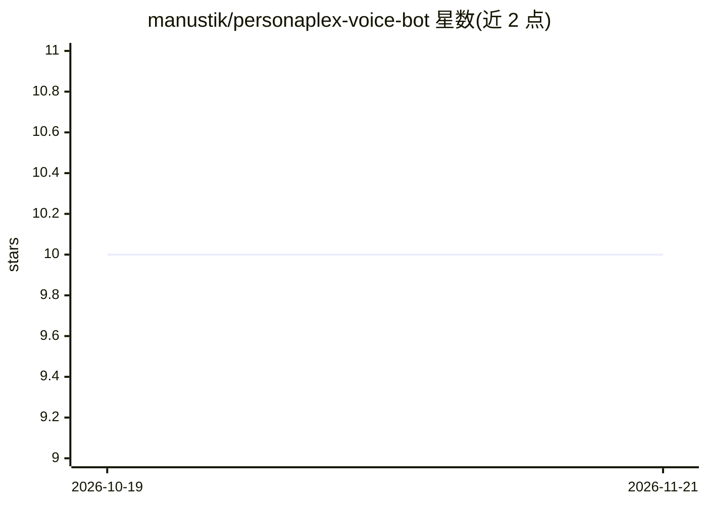

# manustik/personaplex-voice-bot

⭐ 10 · Python · 推送 2026-02-01 · [GitHub](https://github.com/manustik/personaplex-voice-bot) · 个人维护

**接入 Twilio 电话的实时全双工语音对话机器人库**

TypeScript 模块化库，将 NVIDIA PersonaPlex（7B 全双工 speech-to-speech 模型）经桥接服务器接入 Twilio Media Streams，实现电话通话中的实时语音对话。架构分三段：电话—Twilio—TypeScript 桥接—Python 模型服务，内置 24kHz Opus 编解码，支持 GPU 加速与 CPU offloading，并提供 Mock 服务器用于无模型仿真测试。前置条件包括 Node.js 20+、NVIDIA GPU 或足够内存、HuggingFace Token 与 Twilio 账号；已知限制为 7B 模型内存开销大且每实例仅支持单会话。

## 筛选速览

| 维度 | 判定 | 备注 |
|---|---|---|
| AI 角色 | `ai-native` | 本体是模型或模型工具 |
| 许可风险 | `none` | — |
| 部署形态 | `None` |  |
| 模型依赖 | — | README 未给出锁定关系 |
| 硬件要求 | — | 无带数字的原话,不猜 |
| 安装摩擦 | `low` | 无编译、无系统依赖或容器化 |
| 成熟度 | — | 结构信号不足 |

## 能力要点

- 全双工 speech-to-speech 实时对话，基于 NVIDIA PersonaPlex 7B 模型
- 通过 Twilio Media Streams 接入真实电话通话
- 24kHz Opus 编解码，支持 GPU 加速与 CPU offloading
- 提供 Mock 服务器用于无模型的链路仿真测试

## 适用场景

- 构建可通过 Twilio 电话号码呼入的实时语音对话机器人
- 以 TypeScript 库形式集成 PersonaPlex 客户端到自有应用
- 先用 Mock 服务器验证语音链路再接入真实模型

## 场景标签

`语音 Agent` · 领域:对话与助手

## 证据(README 行号)

> L3: A modular TypeScript library for integrating PersonaPlex (NVIDIA's full-duplex speech-to-speech model) with Twilio M
> L7: - 🎙️ **Real-time voice conversations** - Full-duplex speech-to-speech using NVIDIA PersonaPlex

## 星数曲线

2026-10-19 10 → 2026-11-21 10（+0）

---
*卡片 v1 · prompt 1.4 · 生成 2026-11-19 · 置信度 high · 依据 README sha `b2e99d174dd1` · [字段定义](../../DATASET.md)*
