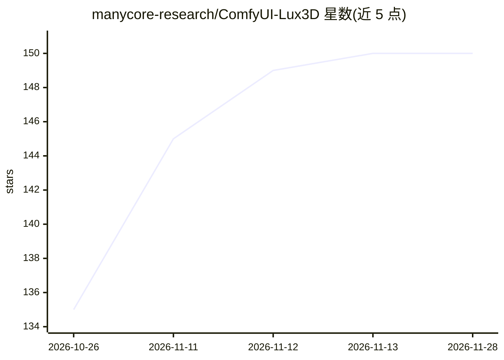

# manycore-research/ComfyUI-Lux3D

⭐ 150 · JavaScript · MIT · 推送 2026-11-13 · [GitHub](https://github.com/manycore-research/ComfyUI-Lux3D) · 组织维护 · 中文 README

**为 ComfyUI 用户提供图/文生 3D 与 3D 后处理的节点扩展**

ComfyUI 扩展，通过调用 Lux3D 云服务，在工作流中把文本描述或 2D 图像转为 3D 模型，并支持网格分割、重拓扑、关节化、人形绑定与人形动画等后处理节点，以及画布内 GLB/PLY 预览。图像输入接受 URL、上游 STRING 或 ComfyUI IMAGE，本地模型经 Asset/OUS 上传；任务提交后自动轮询（最长约 15 分钟）。需在中国/国际两个服务区配置对应 API Key，两者配置不可混用。安装方式包括 ComfyUI CLI、Manager 或手动 clone。

## 筛选速览

| 维度 | 判定 | 备注 |
|---|---|---|
| AI 角色 | `ai-native` | 本体是模型或模型工具 |
| 许可风险 | `permissive` | MIT |
| 部署形态 | `library` | 以包/库形式分发 |
| 模型依赖 | — | README 未给出锁定关系 |
| 硬件要求 | — | 无带数字的原话,不猜 |
| 安装摩擦 | `low` | 无编译、无系统依赖或容器化 |
| 成熟度 | — | 结构信号不足 |

## 能力要点

- 图生 3D 支持 1–8 个图像槽位，输出 GLB/PLY/ZIP
- 文生 3D 提供 7 种风格与面数、PBR、尺寸预测控制
- 5 个后处理节点覆盖分割、重拓扑、绑定与动画
- 多格式导出 USDZ、OBJ、FBX、STL、3MF

## 适用场景

- 为电商制作商品 3D 展示与 AR 试穿素材
- 游戏关卡与角色的资产快速生成
- 家具数字化与室内规划 3D 资产制作

## 场景标签

 · 领域:3D 内容生成

## 证据(README 行号)

> L9: A ComfyUI extension that turns text descriptions or 2D images into 3D models in your workflow.
> L162: - Supports `G1` / `G1-Turbo`, target face count, ZIP / GLB / PLY output, PBR, and size prediction
> L267: 3. Configure the API key in the server environment that starts ComfyUI. Set `LUX3D_API_KEY_CN` for the China servi

## 星数曲线

2026-10-26 135 → 2026-11-28 150（+15）

---
*卡片 v1 · prompt 1.4 · 生成 2026-11-27 · 置信度 high · 依据 README sha `cb76455488b1` · [字段定义](../../DATASET.md)*
