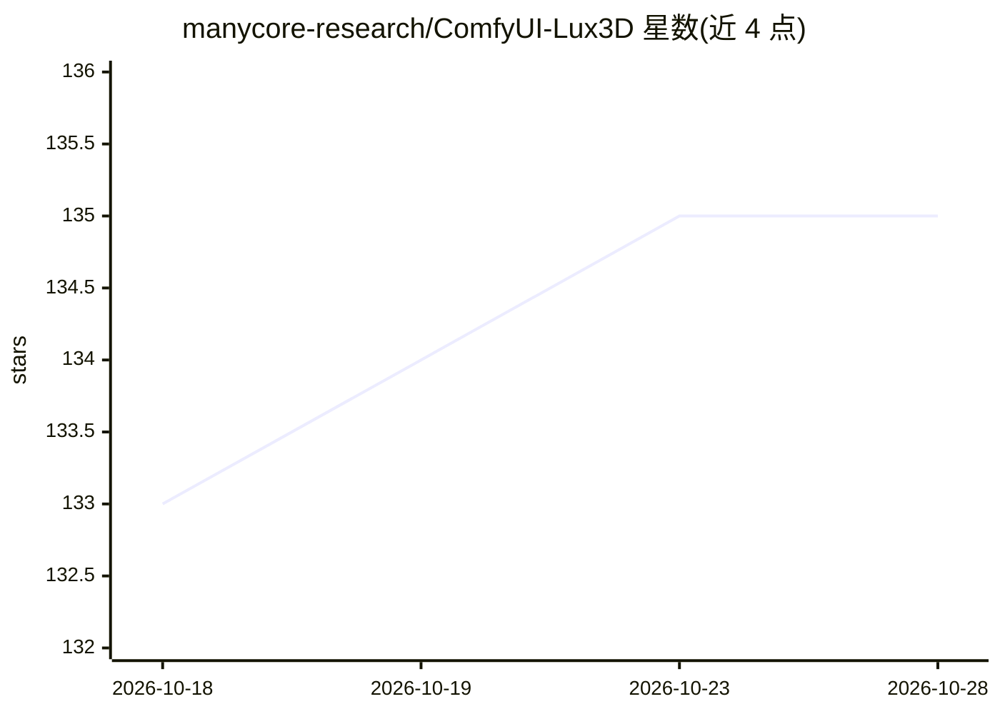

# manycore-research/ComfyUI-Lux3D

⭐ 135 · JavaScript · MIT · 推送 2026-10-14 · [GitHub](https://github.com/manycore-research/ComfyUI-Lux3D) · 组织维护 · 中文 README

**ComfyUI 扩展：调用 Lux3D 云服务从图像/文本生成与处理 3D 模型**

面向 ComfyUI 用户的自定义节点集，通过 Lux3D 云端 API（中国/国际双区域）提供 7 个节点：图像到 3D（最多 8 张图）、文本到 3D（7 种风格）、多视图图像生成、单图生成、多格式导出（USDZ/OBJ/FBX/STL/3MF）、材质重绘，以及在画布内预览 GLB/PLY 的 Viewer。生成任务为异步提交并轮询（约 15 分钟上限）；需在服务端环境配置 LUX3D_API_KEY 才能使用，本地文件经 Asset/OUS 上传后提交任务，仅 Viewer 不上传本地模型。

## 筛选速览

| 维度 | 判定 | 备注 |
|---|---|---|
| AI 角色 | `ai-native` | 本体是模型或模型工具 |
| 许可风险 | `permissive` | MIT |
| 部署形态 | `library` | 以包/库形式分发 |
| 模型依赖 | — | README 未给出锁定关系 |
| 硬件要求 | — | 无带数字的原话,不猜 |
| 安装摩擦 | `low` | 无编译、无系统依赖或容器化 |
| 成熟度 | — | 结构信号不足 |

## 能力要点

- 图像/文本到 3D，支持 ZIP/GLB/PLY 输出、面数与 PBR 控制
- GLB 多格式导出至 USDZ/OBJ/FBX/STL/3MF
- 画布内 GLB/PLY 高斯泼溅预览，本地文件不上传
- 中国（api.aholo3d.cn）与国际（api.aholo.ai）双区域服务

## 适用场景

- 在 ComfyUI 工作流中把产品图转成 3D 模型用于电商/AR 展示
- 游戏与工业设计中原型资产与概念可视化
- 为家具/室内方案快速数字化并预览 3D 资产

## 场景标签

 · 领域:3D 生成/ComfyUI 生态

## 证据(README 行号)

> L9: A ComfyUI extension that turns text descriptions or 2D images into 3D models in your workflow.
> L154: - Provides 1–8 image slots; each accepts a public HTTP(S) URL, an upstream `STRING` URL, or one connected ComfyUI 
> L245: The current release provides seven nodes, which can be combined as needed.

## 星数曲线

2026-10-18 133 → 2026-10-28 135（+2）

---
*卡片 v1 · prompt 1.4 · 生成 2026-10-22 · 置信度 mid · 依据 README sha `00210eb64bc6` · [字段定义](../../DATASET.md)*
