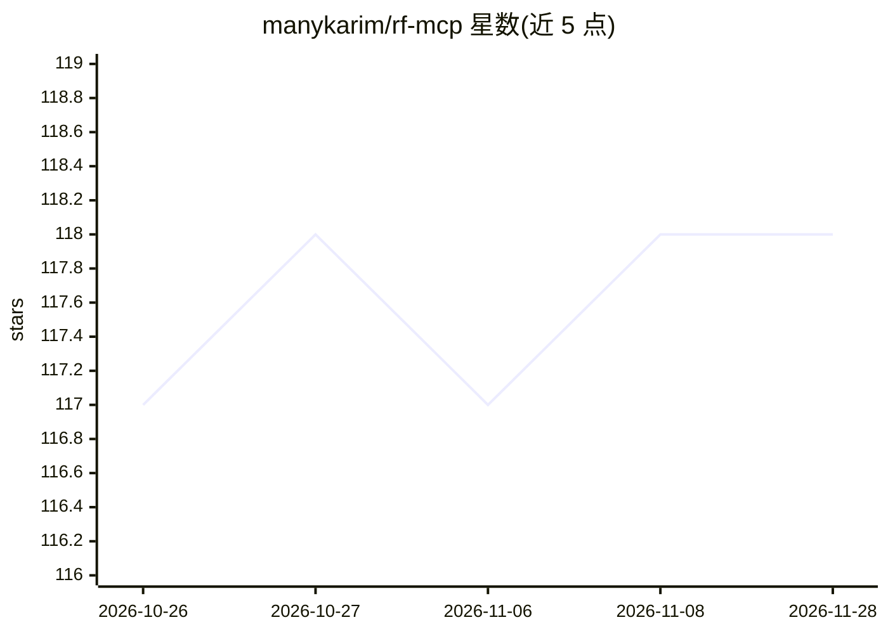

# manykarim/rf-mcp

⭐ 118 · Python · Apache-2.0 · 推送 2026-11-19 · [GitHub](https://github.com/manykarim/rf-mcp) · 个人维护

**让编码 agent 发现/编写/调试/运行 Robot Framework 测试的 MCP 服务器**

基于 RobotCode CLI 与 FastMCP 构建的 Model Context Protocol 服务器，向 Claude Code、OpenAI Codex、GitHub Copilot 等编码 agent 提供 8 个 MCP 工具：套件发现、语义静态分析、关键字文档、测试执行、结果查询/合并、有状态 REPL 编写（rf_repl）、实时调试（rf_debug）与错误恢复提示（rf_diagnose）。支持本地、远程测试运行器与零守护远程 MCP 三种拓扑，通过 MCP 提供 SKILL.md 技能目录与自定义 hints.toml 错误提示，内置 OpenTelemetry 观测。需 Python 3.10+ 与 uv 0.12+，当前 2.0 版本尚未发布到 PyPI，PyPI 上仍为 0.36.x。

## 筛选速览

| 维度 | 判定 | 备注 |
|---|---|---|
| AI 角色 | `ai-ecosystem` | LLM/agent 周边工具 |
| 许可风险 | `permissive` | Apache-2.0 |
| 部署形态 | `self-host` | docker 或自建部署 |
| 模型依赖 | — | README 未给出锁定关系 |
| 硬件要求 | — | 无带数字的原话,不猜 |
| 安装摩擦 | `low` | 无编译、无系统依赖或容器化 |
| 成熟度 | — | 结构信号不足 |

## 能力要点

- 8 个基于 robotcode 的 MCP 工具（发现/分析/文档/执行/结果/REPL/调试/诊断）
- 三种执行拓扑：本地、远程测试运行器、零守护远程 MCP（无额外客户端守护进程）
- 通过 MCP 提供 SKILL.md 技能目录，支持项目级自定义技能与 hints.toml 错误恢复规则热加载
- 提供 Docker 镜像（含浏览器/Selenium/Requests 库与 VNC 显示）与 OpenTelemetry 指标

## 适用场景

- 在 Claude Code/Codex 等编码 agent 中直接编写和调试 Robot Framework 测试
- 在 CI 管道或远程测试容器中由 agent 触发测试执行并查询结果
- 为团队自定义库与页面对象模式编写项目级技能供 agent 使用

## 场景标签

`编码 Agent` · 领域:编码与开发

## 证据(README 行号)

> L23: `rf-mcp` is a lean, customizable Model Context Protocol (MCP) server built on **RobotCode (`>=2.9.0.dev115`) CLI**,
> L25: It empowers coding agents (**Claude Code**, **OpenAI Codex**, **Google Antigravity (`agy`)**, **GitHub Copilot**, *

## 星数曲线

2026-10-26 117 → 2026-11-28 118（+1）

---
*卡片 v1 · prompt 1.4 · 生成 2026-11-28 · 置信度 high · 依据 README sha `890dda05bc76` · [字段定义](../../DATASET.md)*
