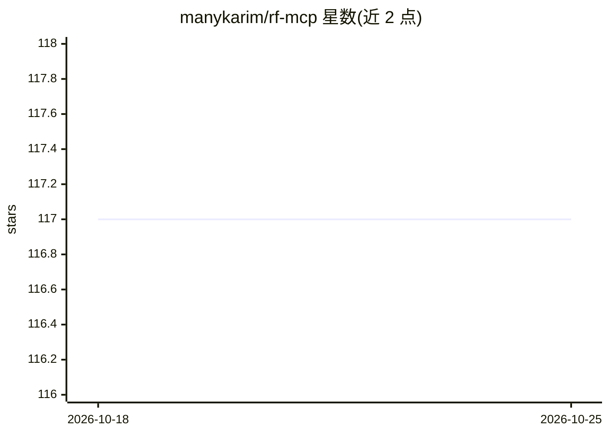

# manykarim/rf-mcp

⭐ 117 · Python · Apache-2.0 · 推送 2026-10-20 · [GitHub](https://github.com/manykarim/rf-mcp) · 个人维护

**让编码代理通过 MCP 实时执行并生成 Robot Framework 测试**

rf-mcp 是一个 Model Context Protocol 服务器，将 Robot Framework 测试能力接入编码代理：代理可发现关键字，针对 Browser、Selenium、Appium、Requests、数据库或桌面实时逐步执行测试，步骤通过后生成 .robot 测试套件。通过 robotmcp install 可自动注册到 Claude Code、Codex、GitHub Copilot、Gemini CLI 等八种代理；测试在 rf-mcp 所在的 Python 进程中执行，已有 RF 项目可挂载项目环境。提供 uv/pip/pipx 安装、Docker 镜像（含 VNC 版）、可选 Django 仪表盘与库插件系统；桌面自动化依赖的 PlatynUI 为预发布版，需显式安装且平台受限。

## 筛选速览

| 维度 | 判定 | 备注 |
|---|---|---|
| AI 角色 | `ai-ecosystem` | LLM/agent 周边工具 |
| 许可风险 | `permissive` | Apache-2.0 |
| 部署形态 | `self-host` | docker 或自建部署 |
| 模型依赖 | locked-api |  |
| 硬件要求 | — | 无带数字的原话,不猜 |
| 安装摩擦 | `low` | 无编译、无系统依赖或容器化 |
| 成熟度 | — | 结构信号不足 |

## 能力要点

- 代理逐步实时执行测试，通过后生成 .robot 套件
- 支持 Browser/Selenium/Appium/Requests/数据库/桌面等多类测试库（extras 按需安装）
- 一条命令注册到 Claude Code、Codex、Copilot 等 8 种编码代理
- 提供 Docker 镜像（headless 与 VNC 版）与可选 Django 仪表盘

## 适用场景

- 用自然语言让编码代理编写并验证 Robot Framework 测试
- 在已有 Robot Framework 项目上让 AI 代理复用自定义关键字库
- CI 环境中通过 headless Docker 镜像运行 MCP 测试服务

## 场景标签

`浏览器自动化` `GUI 自动化` `代码生成` · 领域:效率与自动化

## 证据(README 行号)

> L10: RobotMCP (`rf-mcp`) is a Model Context Protocol (MCP) server that hands your coding
> L11: agent the keys to Robot Framework. The agent discovers keywords, runs steps *live*
> L295: RobotMCP sends server-level instructions to LLMs via the MCP `initialize` response, guiding them to discover keywo

## 星数曲线

2026-10-18 117 → 2026-10-25 117（+0）

---
*卡片 v1 · prompt 1.4 · 生成 2026-10-23 · 置信度 high · 依据 README sha `6a13cb6e932c` · [字段定义](../../DATASET.md)*
