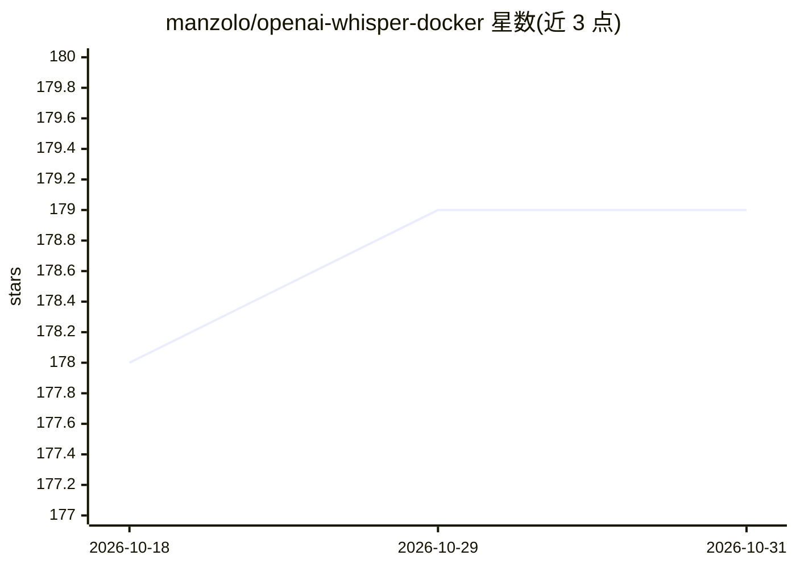

# manzolo/openai-whisper-docker

⭐ 179 · Dockerfile · MIT · 推送 2026-07-18 · [GitHub](https://github.com/manzolo/openai-whisper-docker) · 个人维护

**运行 OpenAI Whisper 语音识别的 GPU/CPU Docker 镜像**

围绕 OpenAI Whisper 的非官方社区 Docker 封装：基于 Ubuntu 24.04 与 Python 3.12，打包 Whisper、PyTorch（含 CUDA 或 CPU-only 变体）与 ffmpeg 等依赖，提供 docker pull 预构建镜像、Docker Compose 与 docker run 三种运行方式。用户将音频放入挂载目录即可执行转录，输出落回同目录；模型缓存通过卷挂载持久化。需自备 Docker，GPU 模式需 NVIDIA Container Toolkit。作者声明为个人爱好维护、不保证支持。

## 筛选速览

| 维度 | 判定 | 备注 |
|---|---|---|
| AI 角色 | `ai-native` | 本体是模型或模型工具 |
| 许可风险 | `permissive` | MIT |
| 部署形态 | `self-host` | docker 或自建部署 |
| 模型依赖 | — | README 未给出锁定关系 |
| 硬件要求 | `cpu-ok` | |
| 安装摩擦 | `low` | 无编译、无系统依赖或容器化 |
| 成熟度 | — | 结构信号不足 |

## 能力要点

- GHCR 预构建镜像含 GPU（~13 GB）与 CPU-only（~3.5 GB）两种变体
- 提供 docker compose 与 docker run 的 GPU/CPU 运行命令
- 模型缓存（./models）与音频输入输出（./audio-files）通过卷挂载持久化
- 支持 turbo（~8 GB VRAM）与 large-v3（10-15 GB VRAM）模型

## 适用场景

- 在 Docker 环境中本地运行 Whisper 做音频转文字
- GPU 或纯 CPU 环境下批量转录音频文件
- 作为自托管语音识别服务的基础镜像

## 场景标签

`语音识别` · 领域:感知与多模态

## 证据(README 行号)

> L9: This Docker image provides a convenient environment for running OpenAI Whisper, a powerful automatic speech recognit
> L51: docker compose run --rm whisper-gpu whisper audio-file.mp3 --device cuda --model turbo --language Italian --output_

## 星数曲线

2026-10-18 178 → 2026-10-31 179（+1）

---
*卡片 v1 · prompt 1.4 · 生成 2026-10-22 · 置信度 high · 依据 README sha `bfd9000d3d4e` · [字段定义](../../DATASET.md)*
