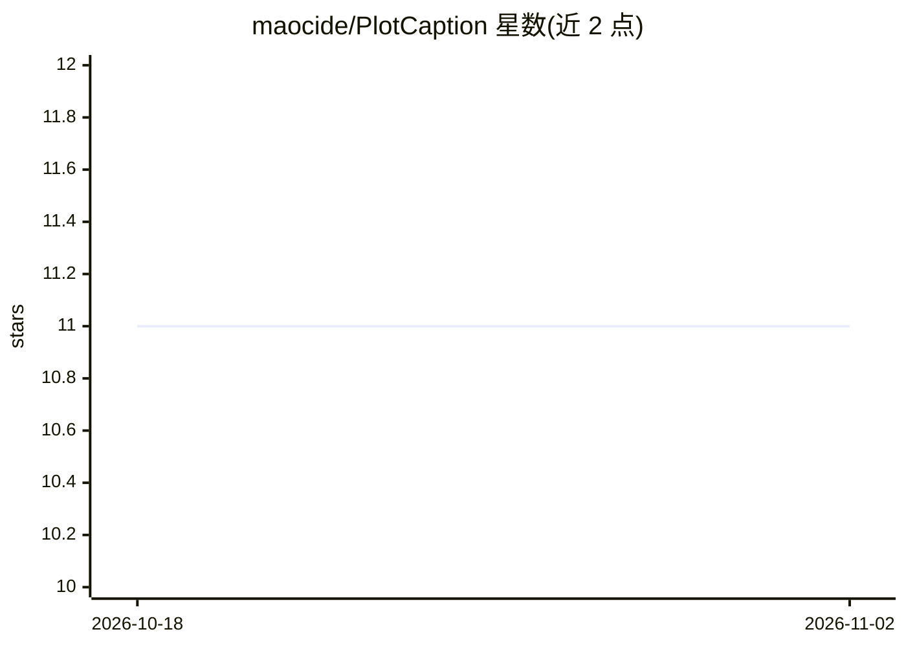

# maocide/PlotCaption

⭐ 11 · Python · GPL-3.0 · 推送 2026-05-01 · [GitHub](https://github.com/maocide/PlotCaption) · [官网](https://github.com/maocide/PlotCaption) · 个人维护

**本地图像转角色设定与 SD 提示词的桌面 AI 工具**

面向角色扮演写作者与 Stable Diffusion 用户的本地桌面应用：输入一张图片，先由本地运行的视觉语言模型（ToriiGate、JoyCaption 等，可扩展 profile）生成详细描述与 booru 标签，再通过用户接入的本地或远程 LLM 生成角色卡与 SD 提示词；提示词模板可用文本文件动态加载自定义。核心图像分析 100% 本地，Windows 提供解压即用的 zip 发布包，也可 Python 3.9+ 源码运行；13B 模型约需 15.5 GB 显存，低配可 GPU offload 或 CPU 运行（速度很慢）。

## 筛选速览

| 维度 | 判定 | 备注 |
|---|---|---|
| AI 角色 | `ai-native` | 本体是模型或模型工具 |
| 许可风险 | `viral` | GPL-3.0 |
| 部署形态 | `desktop` | 安装包/桌面程序 |
| 模型依赖 | — | README 未给出锁定关系 |
| 硬件要求 | `cpu-ok` | |
| 安装摩擦 | `medium` | 含编译或系统依赖之一 |
| 成熟度 | — | 结构信号不足 |

## 能力要点

- 单图同时产出角色卡与 Stable Diffusion 提示词的双输出流程
- 核心图像分析 100% 本地，支持接入本地 LLM 实现全离线创作
- VLM profile 可插拔，提示词模板可由文本文件动态加载自定义
- 低显存时自动 GPU offload，支持纯 CPU 运行

## 适用场景

- 从一张图片快速生成带背景故事的角色卡用于角色扮演
- 自动生成叙事风格的详细 Stable Diffusion 提示词
- 在不联网、不经过内容过滤的环境下进行本地创作

## 场景标签

`提示工程` `AI 写作` · 领域:Agent 开发

## 证据(README 行号)

> L9: 1. **Rich, detailed character lore** for all you storytellers and roleplayers out there.
> L10: 2. **Exquisitely detailed Stable Diffusion prompts** for the AI artists who are tired of wrestling with tags.
> L24: * 🏠 **Hybrid Local Power:** Core image analysis runs 100% on your machine. For the creative text generation, plug i

## 星数曲线

2026-10-18 11 → 2026-11-02 11（+0）

---
*卡片 v1 · prompt 1.4 · 生成 2026-11-02 · 置信度 mid · 依据 README sha `b45efb3ab066` · [字段定义](../../DATASET.md)*
