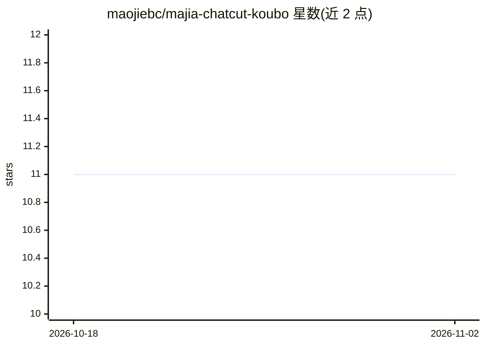

# maojiebc/majia-chatcut-koubo

⭐ 11 · JavaScript · MIT · 推送 2026-10-26 · [GitHub](https://github.com/maojiebc/majia-chatcut-koubo) · [官网](https://clawhub.ai/maojiebc/skills/majia-chatcut-koubo) · 个人维护 · 中文 README

**ChatCut 口播视频稳剪的 Agent Skill：一句话入口+可恢复剪辑流程**

面向普通口播创作者的 ChatCut 官方生态外的 Agent Skill 包：把『用马甲稳剪』等一句话需求拆成可恢复的剪辑阶段——读取项目与时间线、转写、按低/中/高风险分流处理口误、生成代表样片供确认，确认后才扩展整片并处理声音衔接与字幕，最终交回可继续手工编辑的 ChatCut 时间线。提供四套可复现默认方案、检查点与中断恢复协议、证据分离的交付状态报告（PASS/FAIL/UNVERIFIED/STALE 等）。README 明确声明完整口播端到端仍为 UNVERIFIED，不自动导出或发布视频。通过 gh skill install 安装，开发验证要求 Node 24.18.0。

## 筛选速览

| 维度 | 判定 | 备注 |
|---|---|---|
| AI 角色 | `ai-ecosystem` | LLM/agent 周边工具 |
| 许可风险 | `permissive` | MIT |
| 部署形态 | `None` |  |
| 模型依赖 | — | README 未给出锁定关系 |
| 硬件要求 | — | 无带数字的原话,不猜 |
| 安装摩擦 | `low` | 无编译、无系统依赖或容器化 |
| 成熟度 | `idea` | |

## 能力要点

- 一句话意图路由到四套默认方案（balanced-stable/tight-short/trust-longform/screen-demo）
- 低/中/高风险分流：只自动处理有证据的低风险项，样片确认后才扩展整片
- 检查点与恢复协议：写入前后超时、部分写入、手工修改（STALE 标记）均有处理路径
- 证据分离交付报告：结构/画面/音频/人耳/隐私/用户确认分项记录状态

## 适用场景

- 口播视频创作者用一句话让助手先清理口误再做代表样片确认
- 长口播/录屏内容按安全边界稳剪，保护数字、专名与论证链
- 剪辑中断后从检查点恢复，不覆盖手工修改

## 场景标签

`图像视频处理` · 领域:感知与多模态

## 证据(README 行号)

> L6: **ChatCut口播 · 马甲实战版｜一句话稳剪与可恢复主流程**
> L14: 安装后，在支持 Skill 的助手里说：
> L153: ChatCut 当前官方 Skills 负责项目操作、素材导入、转写、口播基础方法、验证、音乐、动效、生成、导出和产品帮助。本包不复制它们的参数教程，只负责：

## 星数曲线

2026-10-18 11 → 2026-11-02 11（+0）

---
*卡片 v1 · prompt 1.4 · 生成 2026-11-02 · 置信度 high · 依据 README sha `32903c0c810f` · [字段定义](../../DATASET.md)*
