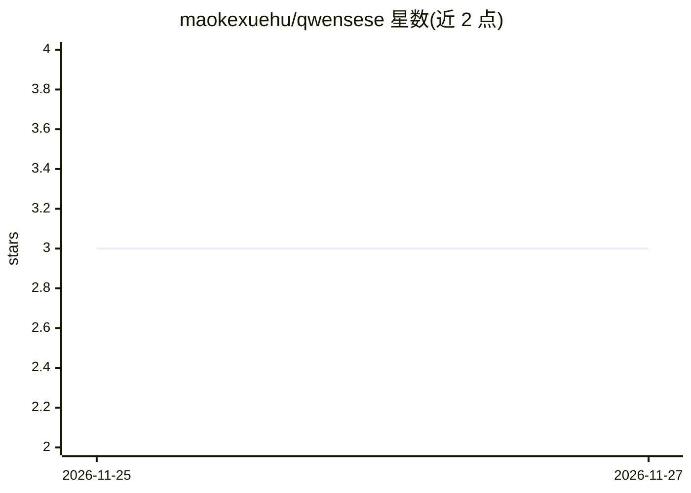

# maokexuehu/qwensese

⭐ 3 · Python · MIT · 推送 2026-11-21 · [GitHub](https://github.com/maokexuehu/qwensese) · 个人维护 · 中文 README

**面向本地用户的零依赖角色扮演对话台，基于 Ollama 与 Markdown 角色卡**

用 Python 标准库实现的 HTTP 服务与单页 Web UI，从本地 Ollama 模型流式获取对话输出，不需要联网、账号、API key 或第三方 Python 包。角色卡为 `personas/*.md` 格式，系统提示词每轮现场拼装，改动下一条消息即生效。附带硬件选型脚本，检测显卡/显存后按档位推荐 Qwen GGUF 量化；提供 `/v1` OpenAI 兼容层、对话存档、上下文压缩摘要、角色卡生成等功能。默认使用消融拒答方向的 27B 模型，无内容过滤，仅面向成年人的虚构角色扮演。

## 筛选速览

| 维度 | 判定 | 备注 |
|---|---|---|
| AI 角色 | `ai-native` | 本体是模型或模型工具 |
| 许可风险 | `permissive` | MIT |
| 部署形态 | `desktop` | 安装包/桌面程序 |
| 模型依赖 | local-ok | 支持本地模型 |
| 硬件要求 | `gpu-8g` | |
| 安装摩擦 | `low` | 无编译、无系统依赖或容器化 |
| 成熟度 | — | 结构信号不足 |

## 能力要点

- 零第三方依赖：纯 Python 标准库后端 + 无框架单页前端
- Markdown 角色卡即改即生效，SYSTEM 每轮现场拼装
- 硬件选型脚本检测显卡/显存并推荐 GGUF 量化与下载命令
- 提供 `/v1` OpenAI 兼容层与 20 个 `/api/*` 接口

## 适用场景

- 在本机离线运行虚构角色的角色扮演对话
- 同一 Wi-Fi 下用手机浏览器访问本地对话服务
- 按自己的显卡显存选型并下载对应量化模型

## 场景标签

`聊天机器人` · 领域:对话与助手

## 证据(README 行号)

> L9: 实现的零第三方依赖本机角色扮演对话台。**
> L29: - **先量显卡再选模型**：`scripts/model_advisor.py` 检测显卡/显存/内存，按档位推荐 Qwen GGUF 量化，网页里点「硬件选型」也能看下载/导入命令；不再"先下 13 GB 再发现跑不动"。
> L31: - **日常功能齐全**：对话存档、上下文压缩摘要、重新生成/撤回、叙事者模式、"帮我想"下一步建议、从旧对话或一段描述生成角色卡。

## 星数曲线

2026-11-25 3 → 2026-11-27 3（+0）

---
*卡片 v1 · prompt 1.4 · 生成 2026-11-24 · 置信度 mid · 依据 README sha `1ef27f4d3989` · [字段定义](../../DATASET.md)*
