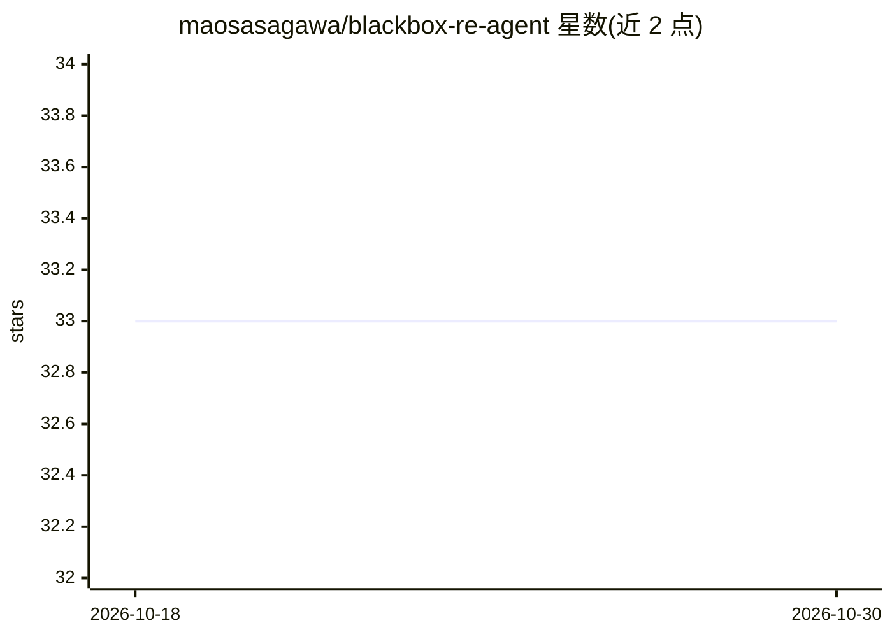

# maosasagawa/blackbox-re-agent

⭐ 33 · Python · Apache-2.0 · 推送 2026-08-12 · [GitHub](https://github.com/maosasagawa/blackbox-re-agent) · 个人维护 · 中文 README

**对话式黑盒逆向分析 agent：自然语言驱动整套逆向工具链**

基于 pi coding agent 的静态逆向分析 agent：用户以自然语言提问，agent 自动驱动 triage、解包、反汇编、Ghidra 反编译、angr 符号执行等工具，产出带地址/符号证据的逻辑分析报告。支持 apk、Android OTA/系统镜像、汽车交付物、.o、.hex、exe、ELF/PE/Mach-O 与裸固件；缺失工具可经 provision 按需安装。仅做静态分析，不运行样本；模型不写死，使用 pi 已配置的任意 provider。另提供单一 Skill 入口供 Claude Code / Codex 使用，工具链与脚本不依赖 pi。

## 筛选速览

| 维度 | 判定 | 备注 |
|---|---|---|
| AI 角色 | `ai-native` | 本体是模型或模型工具 |
| 许可风险 | `permissive` | Apache-2.0 |
| 部署形态 | `desktop` | 安装包/桌面程序 |
| 模型依赖 | — | README 未给出锁定关系 |
| 硬件要求 | — | 无带数字的原话,不猜 |
| 安装摩擦 | `low` | 无编译、无系统依赖或容器化 |
| 成熟度 | — | 结构信号不足 |

## 能力要点

- 自然语言驱动 radare2/Ghidra/angr/jadx 等工具链，用户不手敲命令
- 支持 apk、Android OTA/系统镜像、汽车 ECU 交付物（A2L/DBC/ARXML/ODX 等）多类格式
- provision 工具按环境自动装配缺失工具链，安装器幂等
- 统一 Skill 入口 $analyze-blackbox-artifact 兼容 Claude Code / Codex，核心脚本不依赖 pi

## 适用场景

- 我拿到无源码的 ECU 固件/交付物，需要搞清控制逻辑并做安全评估
- 分析可疑 APK 是否偷偷上传数据
- CTF 中求解 crackme 注册码或口令校验
- Android OTA/系统镜像逐层解包并扫描 init/SELinux/特权应用

## 场景标签

`网络安全` · 领域:学习与行业

## 证据(README 行号)

> L5: 基于 pi coding agent 的逆向分析 agent。
> L7: APK 有没有偷偷上传数据？"——模型会**自动驱动整套逆向工具链**：识别文件、解包、反汇编、用
> L303: 仅用于授权分析（恶意软件研究、CTF、审计、你自己的程序）。Agent 只重建并解释程序逻辑，不产出

## 星数曲线

2026-10-18 33 → 2026-10-30 33（+0）

---
*卡片 v1 · prompt 1.4 · 生成 2026-10-25 · 置信度 mid · 依据 README sha `56326a3dd79a` · [字段定义](../../DATASET.md)*
