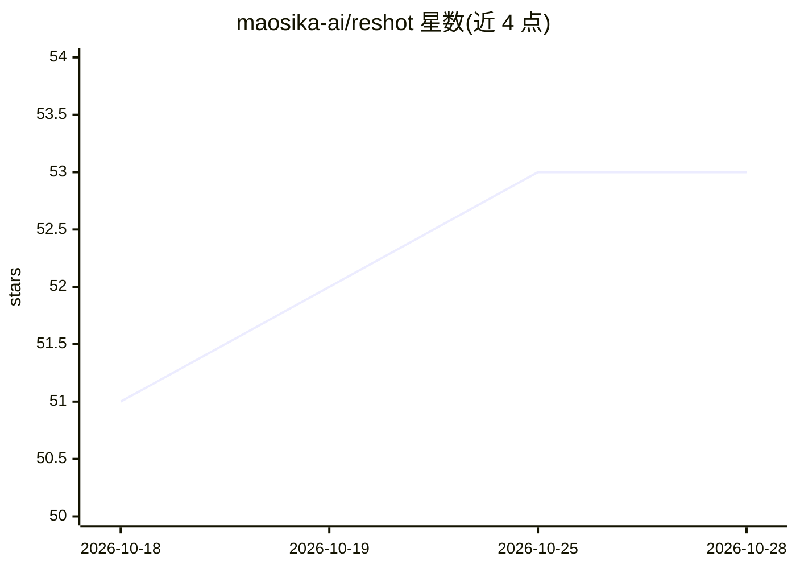

# maosika-ai/reshot

⭐ 53 · Python · Apache-2.0 · 推送 2026-09-28 · [GitHub](https://github.com/maosika-ai/reshot) · [官网](https://www.maosika.com) · 组织维护 · 中文 README

**把参考视频转成深度图/骨架/边缘线控制视频，供AI视频模型复刻运镜动作**

输入 .mp4、输出控制视频的命令行与本地网页工具，服务 AI 短剧/视频制作流程：将参考视频转为深度图（Video Depth Anything）、OpenPose 骨架（DWPose，含跨帧跟踪与平滑）或 canny 边缘线，供 Seedance 2.0/2.5 参考视频、MiniMax H3（含 Fun ControlNet pose 输入）与 ComfyUI 使用，从而复刻动作与运镜而舍弃原人物外观。提供 pip/uvx 安装、Colab 免装路径、批量处理与关键点 JSON 导出；pose 依赖可选安装，Mac 上姿态模型跑 CPU。

## 筛选速览

| 维度 | 判定 | 备注 |
|---|---|---|
| AI 角色 | `ai-native` | 本体是模型或模型工具 |
| 许可风险 | `permissive` | Apache-2.0 |
| 部署形态 | `desktop` | 安装包/桌面程序 |
| 模型依赖 | — | README 未给出锁定关系 |
| 硬件要求 | `gpu-8g` | |
| 安装摩擦 | `medium` | 含编译或系统依赖之一 |
| 成熟度 | — | 结构信号不足 |

## 能力要点

- 三种控制视频：depth（默认）/pose/canny，可一次全出
- pose 路径用 DWPose + 身份跟踪 + One-Euro 平滑，可导出 134 点关键点 JSON
- --target 按 Seedance/H3 API 规则（fps/帧尺寸/时长上限）预设输出
- 提供本地网页界面、Colab 免装路径与 ComfyUI 节点

## 适用场景

- 让 Seedance/MiniMax H3 按参考视频复刻打斗、舞蹈动作与镜头运动
- 避免参考视频中真人面孔触发平台内容审查
- 批量把片段文件夹转成控制视频供视频模型使用

## 场景标签

`视频生成` `图像视频处理` · 领域:内容生成

## 证据(README 行号)

> L3:  ReShot turns a reference video into a depth map, a skeleton or a line video, so Seedance or MiniMax H3 can repeat i
> L37: Technically: depth is monocular video depth estimation (Video Depth Anything), normalised once over the whole clip 
> L92: **Seedance 2.0 / 2.5.** Upload `depth.mp4` as a reference video. In the prompt, point at it and describe the people

## 星数曲线

2026-10-18 51 → 2026-10-28 53（+2）

---
*卡片 v1 · prompt 1.4 · 生成 2026-10-24 · 置信度 high · 依据 README sha `31428dd5ebe7` · [字段定义](../../DATASET.md)*
