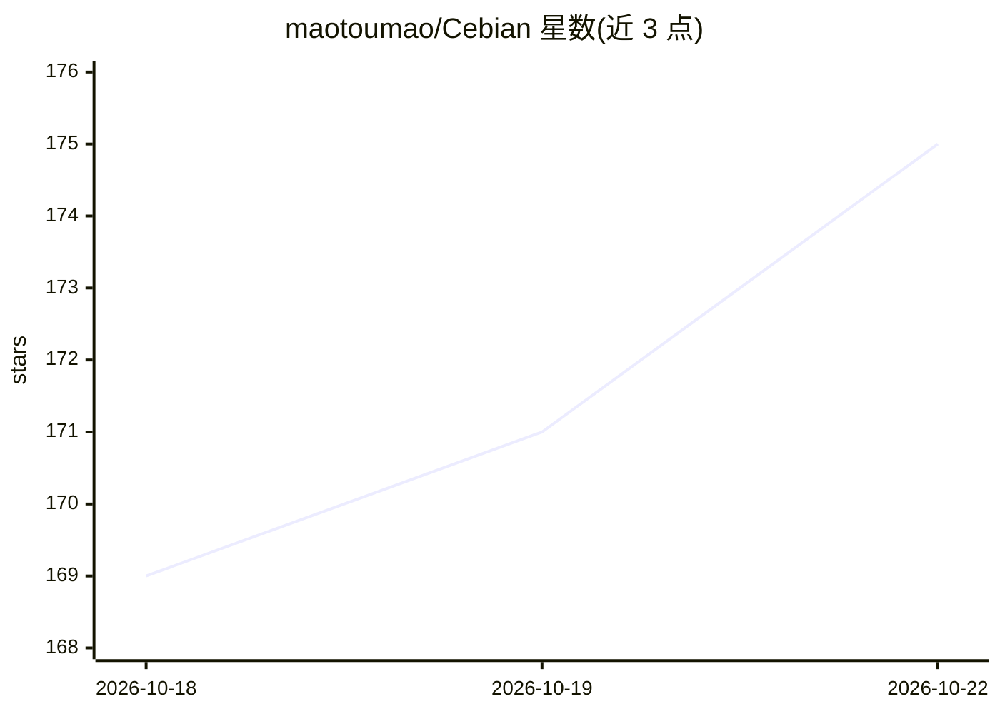

# maotoumao/Cebian

⭐ 175 · TypeScript · AGPL-3.0 · 推送 2026-10-20 · [GitHub](https://github.com/maotoumao/Cebian) · [官网](https://cebian.catcat.work) · 个人维护 · 中文 README

**浏览器侧边栏 AI 助手扩展：自带 API Key 即装即用**

Chrome/Edge/Firefox 浏览器侧边栏 AI 助手扩展，面向普通用户：填入任意模型提供商的 API Key 即可使用，无需注册账号。支持多模型接入（OpenAI、Anthropic、Google 及 OpenAI 兼容端点）、读取当前页面内容作为上下文、模板变量提示词库、Skills、跨对话记忆（本地 Markdown、默认关闭）、MCP 外部工具与移动端模拟。对话与文件均存本地浏览器。以扩展商店安装为主，开发者可用 Node.js 22+ 与 pnpm 从源码构建。

## 筛选速览

| 维度 | 判定 | 备注 |
|---|---|---|
| AI 角色 | `ai-native` | 本体是模型或模型工具 |
| 许可风险 | `dual` | AGPL-3.0 |
| 部署形态 | `None` |  |
| 模型依赖 | — | README 未给出锁定关系 |
| 硬件要求 | — | 无带数字的原话,不猜 |
| 安装摩擦 | `low` | 无编译、无系统依赖或容器化 |
| 成熟度 | — | 结构信号不足 |

## 能力要点

- 多模型接入：OpenAI、Anthropic、Google 及 OpenAI 兼容自定义端点
- 页面感知上下文：读取 URL、标题、选中文本与指定元素
- 跨对话记忆以本地 Markdown 文件保存，可查看可编辑，默认关闭
- 内置 MCP 客户端，接入外部工具

## 适用场景

- 浏览网页时随手调用 AI，无需离开当前页面
- 通过提示词模板与选中文本快速处理页面内容
- 接入自己的模型 API Key，不注册第三方账号

## 场景标签

 · 领域:浏览器 AI 助手/生产力工具

## 证据(README 行号)

> L25: Cebian wants to be **a tool that helps ordinary people in everyday life**. No middleman taking a cut — bring your o
> L35: Cebian is a Chrome extension that puts an AI assistant in the browser side panel. It can read the current page, pic

## 星数曲线

2026-10-18 169 → 2026-10-22 175（+6）

---
*卡片 v1 · prompt 1.4 · 生成 2026-10-22 · 置信度 high · 依据 README sha `c49cb1fbccbc` · [字段定义](../../DATASET.md)*
