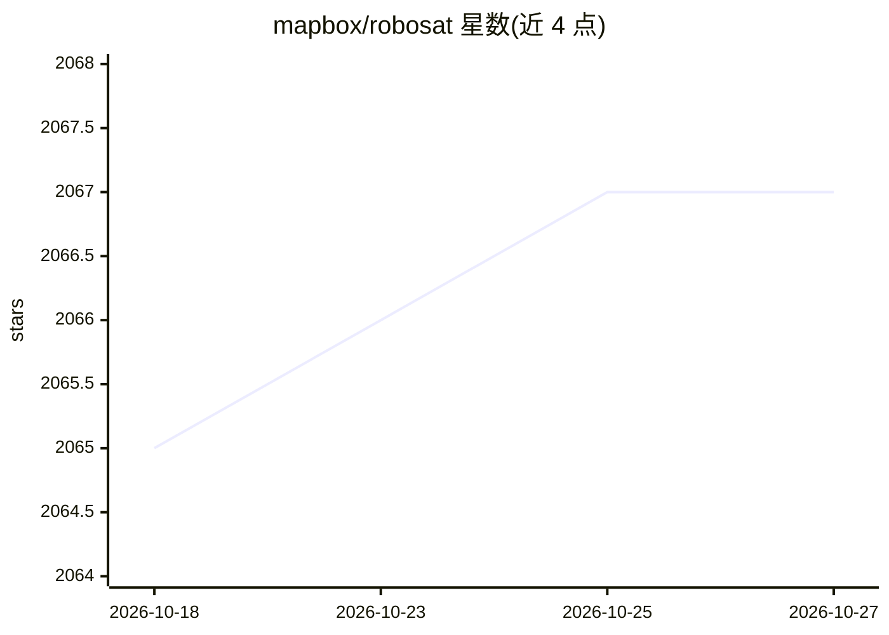

# mapbox/robosat

⭐ 2,067 · Python · MIT · 推送 2026-06-29 · [GitHub](https://github.com/mapbox/robosat) · 组织维护

**遥感影像语义分割管线：从航拍/卫星图提取建筑、道路等要素**

Python 3 编写的端到端管线，从航拍与卫星影像中做语义分割并提取要素（建筑、停车场、道路、水体、车辆等）。流程含数据准备（从 OpenStreetMap 几何生成标签、按 Slippy Map 瓦片下载影像）、全卷积神经网络训练与预测（支持 GPU/CPU）、后处理（去噪、几何简化、输出 GeoJSON）。提供 Docker 镜像（CPU/GPU）、ONNX 导出与按需分割瓦片服务。README 首行声明 Mapbox 已不再维护与开发。训练建议使用 GPU（AWS p2/p3、GTX 1080 TI）。

## 筛选速览

| 维度 | 判定 | 备注 |
|---|---|---|
| AI 角色 | `ai-native` | 本体是模型或模型工具 |
| 许可风险 | `permissive` | MIT |
| 部署形态 | `self-host` | docker 或自建部署 |
| 模型依赖 | — | README 未给出锁定关系 |
| 硬件要求 | — | 无带数字的原话,不猜 |
| 安装摩擦 | `low` | 无编译、无系统依赖或容器化 |
| 成熟度 | — | 结构信号不足 |

## 能力要点

- 端到端管线：数据准备→训练→预测→后处理，含 15 个 rs 子命令
- 从 OpenStreetMap 几何自动生成训练标签掩膜，也支持自带影像/掩膜
- 输出简化 GeoJSON 要素，可与既有 OSM 要素去重
- 提供 CPU/GPU 预构建 Docker 镜像与 ONNX 模型导出

## 适用场景

- 从航拍影像提取建筑轮廓用于制图或分析
- 基于 OpenStreetMap 数据构建自己的地物分割训练集
- 对比预测结果与 OSM 现有要素发现缺失地物

## 场景标签

`目标检测` · 领域:感知与多模态

## 证据(README 行号)

> L15: RoboSat is an end-to-end pipeline written in Python 3 for feature extraction from aerial and satellite imagery.
> L125: The `rs train` tool trains a fully convolutional neural net for semantic segmentation on a dataset with `(image, m

## 星数曲线

2026-10-18 2,065 → 2026-10-27 2,067（+2）

---
*卡片 v1 · prompt 1.4 · 生成 2026-10-21 · 置信度 high · 依据 README sha `17c1f6808d6d` · [字段定义](../../DATASET.md)*
