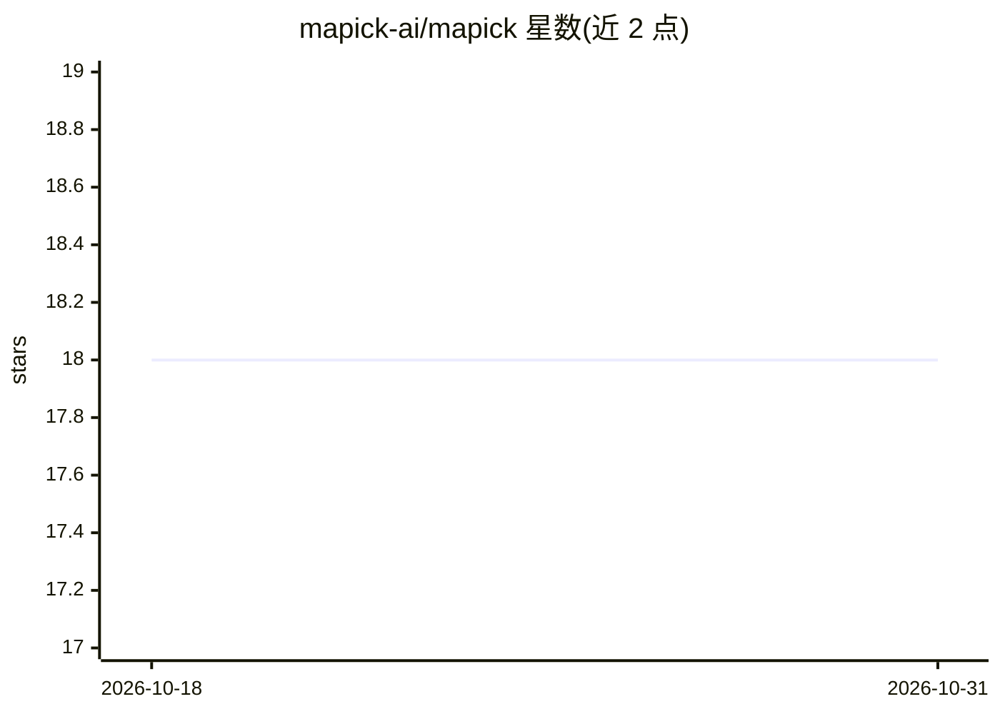

# mapick-ai/mapick

⭐ 18 · JavaScript · MIT · 推送 2026-05-21 · [GitHub](https://github.com/mapick-ai/mapick) · [官网](https://mapick.ai/) · 组织维护

**OpenClaw 技能管理器：隐私脱敏、技能推荐与清理**

面向 OpenClaw agent 框架的技能生命周期管理工具：本地脱敏层在数据离开机器前按 20+ 敏感模式（密钥、证书、数据库 URI、个人身份信息等）替换为 [REDACTED]；基于使用行为做技能推荐与量化缺口分析；扫描并卸载未使用的 zombie 技能；对技能做四维安全评分（代码扫描/权限/社区/外部扫描）并检测 typosquatting；生成 13 类开发者 persona 与 11 个技能捆绑包。技能侧代码 MIT 开源，云端 API（推荐算法、扫描规则）闭源，收集匿名化技能 ID 与时间戳等数据，支持拒终权限与 GDPR 删除。需 OpenClaw 与 Node.js ≥22.14。

## 筛选速览

| 维度 | 判定 | 备注 |
|---|---|---|
| AI 角色 | `ai-ecosystem` | LLM/agent 周边工具 |
| 许可风险 | `permissive` | MIT |
| 部署形态 | `None` |  |
| 模型依赖 | — | README 未给出锁定关系 |
| 硬件要求 | — | 无带数字的原话,不猜 |
| 安装摩擦 | `low` | 无编译、无系统依赖或容器化 |
| 成熟度 | — | 结构信号不足 |

## 能力要点

- 本地脱敏引擎覆盖 20+ 敏感模式，发送前替换为 [REDACTED]
- 四维安全评分（代码/权限/社区/VirusTotal）与 typosquatting 检测
- 7 天后由行为信号驱动的技能推荐与 zombie 清理反馈循环
- 13 类开发者 persona 与 11 个预置技能捆绑包

## 适用场景

- 给 OpenClaw 的技能上下文加一层隐私脱敏保护
- 找出并卸载装了不用的 zombie 技能
- 安装新技能前查看安全评分与替代方案
- 按开发者画像一键安装整套技能捆绑包

## 场景标签

`网络安全` · 领域:学习与行业

## 证据(README 行号)

> L18: **The AI skill manager for OpenClaw.** Protects your privacy, recommends what you need, cleans what you don't use, 
> L22: openclaw skills install mapick

## 星数曲线

2026-10-18 18 → 2026-10-31 18（+0）

---
*卡片 v1 · prompt 1.4 · 生成 2026-10-29 · 置信度 high · 依据 README sha `c18b1c30169f` · [字段定义](../../DATASET.md)*
