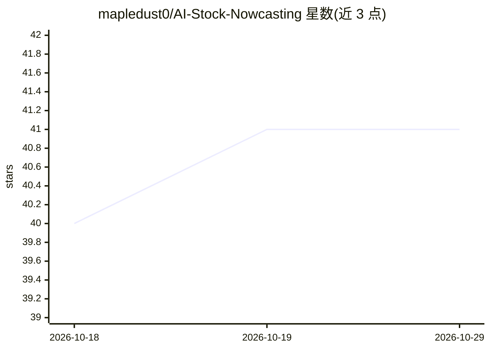

# mapledust0/AI-Stock-Nowcasting

⭐ 41 · HTML · MIT · 推送 2026-06-18 · [GitHub](https://github.com/mapledust0/AI-Stock-Nowcasting) · 组织维护

**北大光华团队的 LLM Agent 股票收益即时预测研究项目**

北京大学光华管理学院两位研究者发起的量化金融研究项目：部署大语言模型以全自主 Agent 工作流（自行生成搜索查询、浏览实时网页、综合信息）对 Russell 1000 全部个股每日生成 -5 到 +5 的吸引力评分，构建价值加权组合。论文报告 Top-20 组合九个月约 50% 累计收益与日度 Fama-French 五因子 alpha 18.4 个基点。仓库主要托管论文结果与交互式可视化，README 声明状态为 Preliminary，仅供研究教育用途，不构成投资建议。

## 筛选速览

| 维度 | 判定 | 备注 |
|---|---|---|
| AI 角色 | `ai-native` | 本体是模型或模型工具 |
| 许可风险 | `permissive` | MIT |
| 部署形态 | `None` |  |
| 模型依赖 | — | README 未给出锁定关系 |
| 硬件要求 | — | 无带数字的原话,不猜 |
| 安装摩擦 | `low` | 无编译、无系统依赖或容器化 |
| 成熟度 | `idea` | |

## 能力要点

- 100% agentic 工作流：模型自主搜索、过滤来源并综合为量化预测
- 对 Russell 1000 全部个股每日生成 -5 到 +5 吸引力评分
- 严格 nowcasting 约束：t-1 收盘后至 t 开盘前生成预测，消除前视偏差
- 提供交互式 Top-N 组合收益可视化（Top 10 至 Top 100）

## 适用场景

- 查看 LLM Agent 选股能力的实证研究结果与图表
- 通过交互式图表探索不同组合规模下的收益与 alpha 衰减
- 作为量化金融与 agentic AI 交叉研究的参考并引用论文

## 场景标签

`金融量化` `科研工具` · 领域:学习与行业

## 证据(README 行号)

> L18: Our framework is **100% agentic**: we do not feed the model news or curated text; it autonomously searches the web,
> L25: * **Mechanism:** Agentic Workflow. The AI autonomously generates search queries, browses the live web, and synthesi

## 星数曲线

2026-10-18 40 → 2026-10-29 41（+1）

---
*卡片 v1 · prompt 1.4 · 生成 2026-10-25 · 置信度 high · 依据 README sha `ea1f29c17efe` · [字段定义](../../DATASET.md)*
