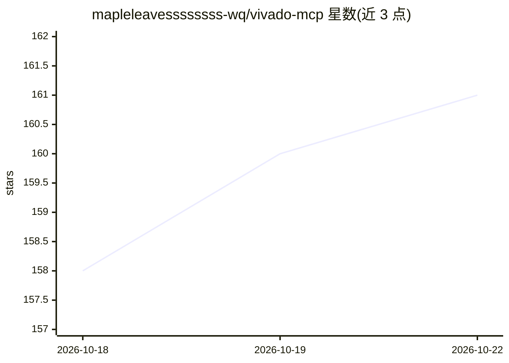

# mapleleavessssssss-wq/vivado-mcp

⭐ 162 · Python · Apache-2.0 · 推送 2026-09-22 · [GitHub](https://github.com/mapleleavessssssss-wq/vivado-mcp) · [官网](https://pypi.org/project/vivado-mcp/) · 个人维护 · 中文 README

**驱动本地 Xilinx Vivado 的 MCP server，供 AI Agent 完成 FPGA 全流程**

面向 Claude Code、Cursor、Codex 等 MCP 客户端的本地 Vivado 控制服务器：提供 32 个工具覆盖会话、综合、实现、时序、CDC、XDC、IP、波形与烧录，通用操作由 run_tcl 承载；支持 GUI/Tcl/attach 三种会话模式，附 11 个工作流 Prompt、5 个 Skills 与 doctor 只读环境自检。诊断建议以中文为主，控制的是用户本机安装的 Vivado 而非云端服务。通过 pip 安装，唯一运行时依赖为 MCP Python SDK 2.x，需本机安装 Xilinx Vivado（2019.1 为主要支持基线）。

## 筛选速览

| 维度 | 判定 | 备注 |
|---|---|---|
| AI 角色 | `ai-ecosystem` | LLM/agent 周边工具 |
| 许可风险 | `permissive` | Apache-2.0 |
| 部署形态 | `library` | 以包/库形式分发 |
| 模型依赖 | — | README 未给出锁定关系 |
| 硬件要求 | — | 无带数字的原话,不猜 |
| 安装摩擦 | `low` | 无编译、无系统依赖或容器化 |
| 成熟度 | — | 结构信号不足 |

## 能力要点

- 32 个 MCP 工具覆盖 FPGA 开发流程与离线解析（xpr/bit/ltx/VCD 均可离线读取）
- GUI / Tcl / attach 三种会话模式，长任务支持异步 job id 查询
- doctor 只读环境自检，--fix 才执行带备份的受限修复
- CRITICAL WARNING 按 ID 分类并给中文修复建议（含 18+ 种已知 ID）

## 适用场景

- 在 Claude Code 或 Cursor 中让 AI 直接跑综合、实现与烧录
- RTL 修改后保存时序基线并比较两轮测量差值
- 离线查询 VCD 中的未知值与握手事件，无需 Vivado 会话
- 烧板前用 check_bitstream_readiness 做 READY/WARN/BLOCK 判定

## 场景标签

`编码 Agent` · 领域:编码与开发

## 证据(README 行号)

> L8: **让 Claude Code、Cursor、Codex 等 AI Agent 安全驱动本地 Xilinx Vivado。**
> L10: 32 个 MCP 工具覆盖会话、综合、实现、时序、CDC、XDC、IP、波形与烧录。可保存结构化时序结果、比较两次测量、离线查询 VCD 中的未知值与握手事件；通用 Vivado 操作由 `run_tcl` 承载。
> L15: > 本项目控制的是**你本机安装的 Vivado**，不是云端综合服务。命令在当前用户权限下执行；工具说明和诊断建议以中文为主。

## 星数曲线

2026-10-18 158 → 2026-10-22 161（+3）

---
*卡片 v1 · prompt 1.4 · 生成 2026-10-22 · 置信度 high · 依据 README sha `1eb8effaded9` · [字段定义](../../DATASET.md)*
