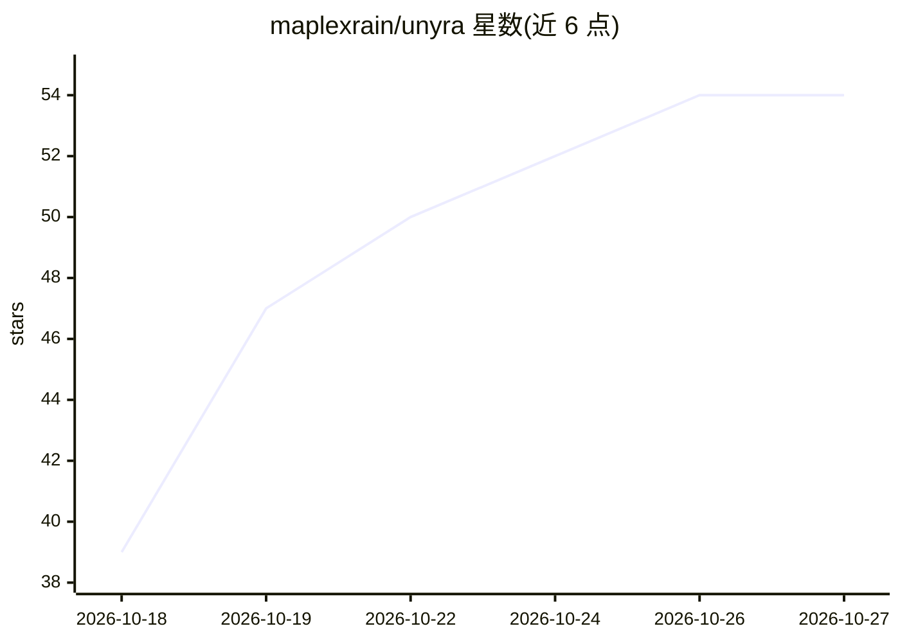

# maplexrain/unyra

⭐ 54 · TypeScript · MIT · 推送 2026-10-25 · [GitHub](https://github.com/maplexrain/unyra) · 个人维护 · 中文 README

**本地优先的 AI 探索式学习桌面应用：知识拆成节点由导师教学**

基于 Electron + React 的 Windows 桌面学习应用：输入学习目标后以知识树（DAG 节点）组织学习，每个节点带教学文档与笔记，由「超级导师」通过 JS 沙箱 api 直接改写文档教学。支持三种导师人格、上下文压缩、考试出卷与 AI 判分、学习状态记录、专注模式守卫监控、文档内代码编译运行与插件系统。数据全部存本机，AI 请求由主进程直发用户配置的服务商，默认 DeepSeek，兼容 OpenAI/Anthropic/Responses 协议及本地 Ollama/vLLM。目前仅提供 Windows 安装包，macOS/Linux 需自行从源码构建。

## 筛选速览

| 维度 | 判定 | 备注 |
|---|---|---|
| AI 角色 | `ai-native` | 本体是模型或模型工具 |
| 许可风险 | `permissive` | MIT |
| 部署形态 | `desktop` | 安装包/桌面程序 |
| 模型依赖 | local-ok | 支持本地模型 |
| 硬件要求 | — | 无带数字的原话,不猜 |
| 安装摩擦 | `low` | 无编译、无系统依赖或容器化 |
| 成熟度 | — | 结构信号不足 |

## 能力要点

- 知识树（DAG 节点）+ 节点级教学文档与笔记的探索式学习
- 超级导师经 JS 沙箱 api 直接改写教学文档、试卷与节点结构
- 内置多家 AI 提供商，兼容 OpenAI/Anthropic/Responses 协议与本地 Ollama/vLLM
- 考试出卷、AI 判分、掌握度估计与错题讲解

## 适用场景

- 从零开始系统学习一个目标，把知识拆成可回看的节点图
- 阅读教学文档时选词即时创建子节点或向 AI 提问
- 按知识点出卷自测并获得针对薄弱项的错题讲解
- 换服务商或本地 Ollama/vLLM 继续用同一套学习数据

## 场景标签

`知识库管理` · 领域:知识与检索

## 证据(README 行号)

> L5: **本地优先的 AI 学习辅助桌面应用——从一个想弄懂的目标出发，把知识逐层拆成可探索的节点。**
> L31: - **导师在文档上动笔**，而不是只在对话框里说话——它写一段 JS 交给沙箱执行，教学正文、节点结构、
> L55: 前缀缓存因此不会因为切节点而整段作废。导师先思考、再写一段 JS 交给沙箱执行——讲解**直接写进教学文档**，

## 星数曲线

2026-10-18 39 → 2026-10-27 54（+15）

---
*卡片 v1 · prompt 1.4 · 生成 2026-10-24 · 置信度 high · 依据 README sha `531b6a21bde2` · [字段定义](../../DATASET.md)*
