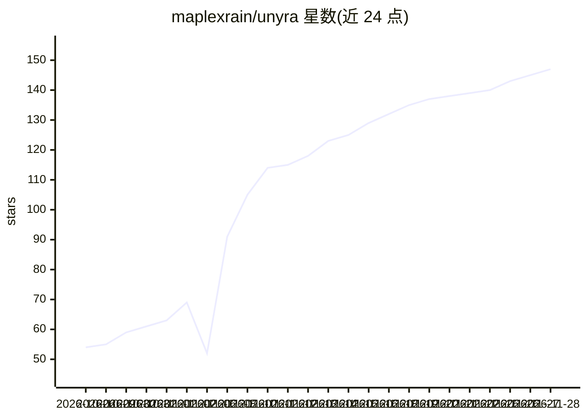

# maplexrain/unyra

⭐ 147 · TypeScript · MIT · 推送 2026-11-27 · [GitHub](https://github.com/maplexrain/unyra) · 个人维护 · 中文 README

**本地优先的 AI 探索式学习桌面应用，把知识拆成拓扑节点学习**

基于 Electron + React 的本地优先桌面学习应用：从学习目标生成 DAG 知识拓扑，AI 导师在沙箱中编排生成教学文档、节点与试卷，输出为本地 Markdown/YAML/JSON 明文文件。内置三层讲解细粒度调节回路（模型推演、表单提问、网络检索 RAG）、用户画像与双层记忆系统、代码沙箱本地编译执行、独立考试窗口与错题追因，以及选词裂变子节点等交互。数据全在本地，模型请求由主进程端到端直连所配置服务商。仅提供 Windows 安装包与便携版；使用需自备 API Key。

## 筛选速览

| 维度 | 判定 | 备注 |
|---|---|---|
| AI 角色 | `ai-native` | 本体是模型或模型工具 |
| 许可风险 | `permissive` | MIT |
| 部署形态 | `desktop` | 安装包/桌面程序 |
| 模型依赖 | local-ok | 支持本地模型 |
| 硬件要求 | — | 无带数字的原话,不猜 |
| 安装摩擦 | `low` | 无编译、无系统依赖或容器化 |
| 成熟度 | — | 结构信号不足 |

## 能力要点

- DAG 知识拓扑画布与一份活的教学文档，支持分屏与行号跳转
- 超级导师通过 JavaScript 沙箱直接读写文档、编排试卷与批注
- 本地代码沙箱执行、PaddleOCR 划词与 SenseVoiceSmall 离线语音输入
- 本地优先存储：纯 Markdown/YAML/JSON 文件，AI 请求端到端直连服务商

## 适用场景

- 从高数这类学科目标出发，生成依赖分明的路线图并逐层学习
- 阅读讲义时选词裂变子节点，深潜前置概念
- 随堂小测客观判分，由 AI 导师批阅主观题并写错题讲解
- 导入 PDF 教材后划词提取、提问与作答

## 场景标签

`RAG` `AI 助手` `文档解析` · 领域:对话与助手

## 证据(README 行号)

> L5:  **Local-First Agentic Learning App · 本地优先的 AI 探索式学习桌面应用**
> L34: |**AI 参与度**|仅在输入框外部打字回答|**超级导师直接动笔**：在沙箱中执行编排，教学文档、节点结构、试卷、批注一次性落定|
> L163: 2. 点击顶栏右上角 **设置 (⚙️)**，在 AI 设置中填入您的 API Key（默认支持 DeepSeek 官方接口，也可配置任意兼容 OpenAI 协议的服务，如通义千问、Kimi、GLM、本地 Ollama 等）；

## 星数曲线

2026-10-26 54 → 2026-11-28 147（+93）

---
*卡片 v1 · prompt 1.4 · 生成 2026-11-27 · 置信度 high · 依据 README sha `3373af33c516` · [字段定义](../../DATASET.md)*
