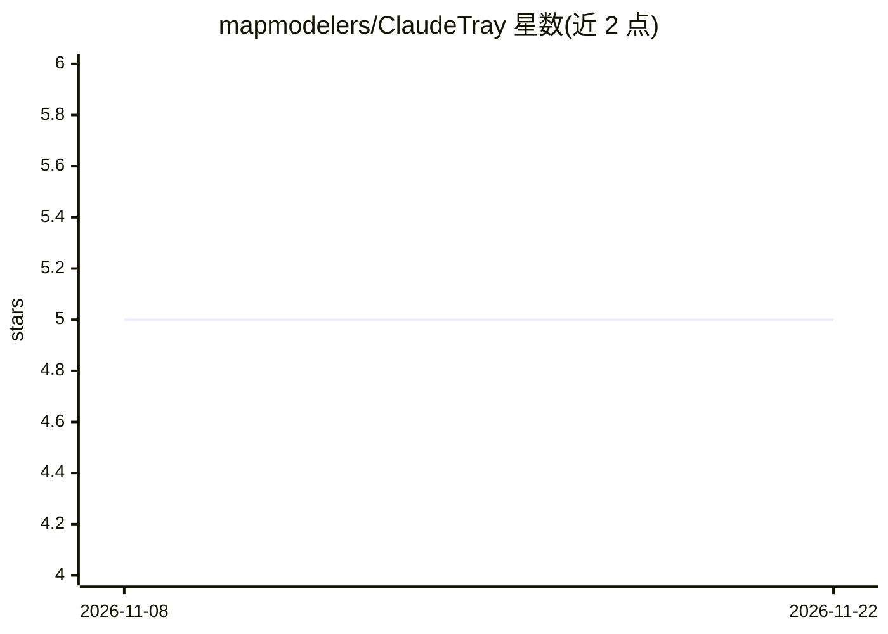

# mapmodelers/ClaudeTray

⭐ 5 · PowerShell · MIT · 推送 2026-11-21 · [GitHub](https://github.com/mapmodelers/ClaudeTray) · [官网](https://mapmodelers.github.io/ClaudeTray/) · 个人维护

**Windows 托盘面板：集中管理 claude.ai 聊天与 Claude Code 会话**

一个 Windows 系统托盘面板，将 claude.ai 聊天与 Claude Code 会话显示在时钟旁：统一列出多路会话及状态（工作中/等待用户/新回复/待执行步骤），支持从面板阅读对话、回复、执行 Claude 列出的命令步骤、应答提问与 Allow/Deny 权限提示，并显示会话与每周用量限额（80%/95% 通知）。工作方式是读取 claude.ai 页面而非公开 API，需付费 Claude 计划；zip 免安装运行，实验性阶段，claude.ai 更新可能破坏功能。

## 筛选速览

| 维度 | 判定 | 备注 |
|---|---|---|
| AI 角色 | `ai-ecosystem` | LLM/agent 周边工具 |
| 许可风险 | `permissive` | MIT |
| 部署形态 | `desktop` | 安装包/桌面程序 |
| 模型依赖 | locked-api |  |
| 硬件要求 | — | 无带数字的原话,不猜 |
| 安装摩擦 | `low` | 无编译、无系统依赖或容器化 |
| 成熟度 | `idea` | |

## 能力要点

- 托盘中统一查看与回复多个 claude.ai 聊天和 Claude Code 会话
- 一键运行 Claude 列出的命令步骤，输出保留并回传给 Claude
- 从面板应答 Claude Code 提问与 Allow/Deny 权限请求
- 显示会话与每周用量限额并发出 80%/95% 通知

## 适用场景

- 同时跟进多个 Claude Code 会话而不切换窗口
- 后台跑一个研究/比价聊天，需要时再看
- 在托盘里批准脚本的权限请求
- 控制用量，接近限额时收到提醒

## 场景标签

`AI 助手` · 领域:对话与助手

## 证据(README 行号)

> L3: A Windows system tray panel for Claude: your claude.ai chats and Claude Code sessions next to the clock, with
> L18: - **All your chats in one list.** claude.ai chats and Claude Code sessions, one line each, with their status:
> L138: - The tray only talks to claude.ai and Anthropic, over HTTPS, plus GitHub when you click Check for updates. No

## 星数曲线

2026-11-08 5 → 2026-11-22 5（+0）

---
*卡片 v1 · prompt 1.4 · 生成 2026-11-21 · 置信度 high · 依据 README sha `2272815f3050` · [字段定义](../../DATASET.md)*
