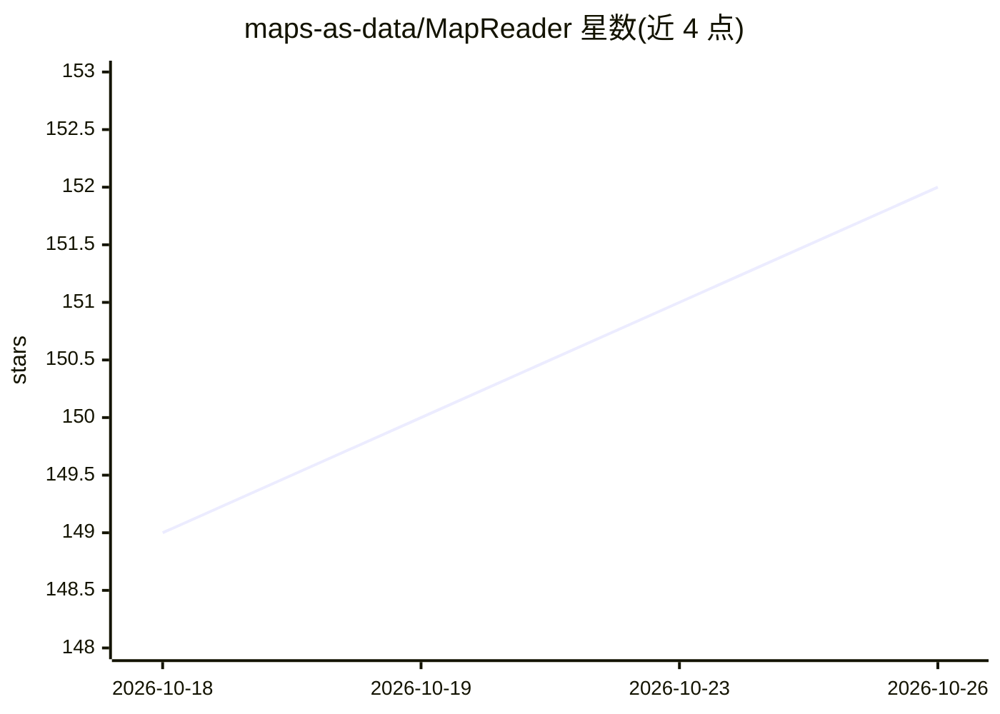

# maps-as-data/MapReader

⭐ 152 · Python · NOASSERTION · 推送 2026-09-13 · [GitHub](https://github.com/maps-as-data/MapReader) · [官网](https://mapreader.readthedocs.io/en/latest/) · 组织维护

**分析地图图像的开源 Python 计算机视觉库**

MapReader 是用于大规模探索和分析地图图像的开源 Python 库，提供两条流水线：分类流水线支持微调分类模型并预测父图像切分出的图块标签；文字检测流水线使用预训练模型检测并识别地图图像中的文字。项目最初在 Living with Machines 项目中开发，用于分析历史地图集合，但可应用于任意领域图像。提供 PyPI 安装、readthedocs 文档、Slack 社区与示例仓库，有 JOSS 论文可供引用。

## 筛选速览

| 维度 | 判定 | 备注 |
|---|---|---|
| AI 角色 | `ai-native` | 本体是模型或模型工具 |
| 许可风险 | `none` | NOASSERTION |
| 部署形态 | `library` | 以包/库形式分发 |
| 模型依赖 | — | README 未给出锁定关系 |
| 硬件要求 | — | 无带数字的原话,不猜 |
| 安装摩擦 | `low` | 无编译、无系统依赖或容器化 |
| 成熟度 | — | 结构信号不足 |

## 能力要点

- 分类流水线：微调模型并预测图像切块的标签
- 文字检测流水线：检测并识别地图图像中的文字
- 可应用于任意领域图像，不限于历史地图

## 适用场景

- 在大规模历史地图集合中识别含特定视觉特征的图块
- 检测和识别地图图像中的文字
- 对任意领域图像做切块分类分析

## 场景标签

`目标检测` `OCR` · 领域:感知与多模态

## 证据(README 行号)

> L16: **MapReader is a open-source python library for exploring and analyzing map images at scale.**
> L20: - Classification pipeline: This pipeline enables users to fine-tune a classification model and predict the labels o
> L21: - Text spotting pipeline: This pipeline enables users to detect and recognize text in map images.

## 星数曲线

2026-10-18 149 → 2026-10-26 152（+3）

---
*卡片 v1 · prompt 1.4 · 生成 2026-10-22 · 置信度 high · 依据 README sha `391e92343d50` · [字段定义](../../DATASET.md)*
