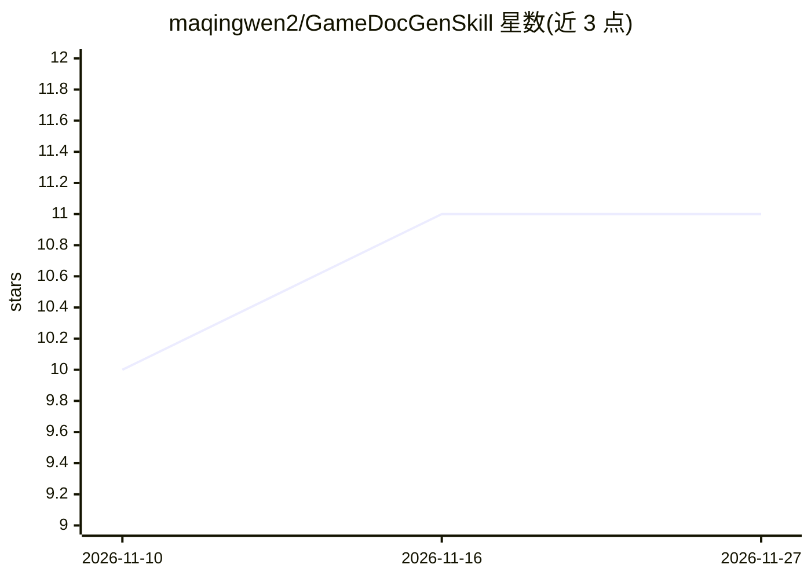

# maqingwen2/GameDocGenSkill

⭐ 11 · Python · 推送 2026-04-23 · [GitHub](https://github.com/maqingwen2/GameDocGenSkill) · 个人维护 · 中文 README

**游戏策划的 AI 技能：截图/视频自动仿写策划案**

面向游戏策划的三阶段流水线工具：预处理截图与视频（关键帧提取、去重）、解析历史策划案模板提取通用结构、融合后生成 Markdown 格式策划案，输出含 UI 布局、交互流程、配置表引用与「需补充」标记。以 Python 脚本与 SKILL.md 形式提供，可安装为 WorkBuddy/OpenClaw/CodeBuddy 等 agent 平台的 Skill，也可直接调用脚本。FFmpeg 为可选依赖，仅视频处理需要。

## 筛选速览

| 维度 | 判定 | 备注 |
|---|---|---|
| AI 角色 | `ai-native` | 本体是模型或模型工具 |
| 许可风险 | `permissive` | — |
| 部署形态 | `library` | 以包/库形式分发 |
| 模型依赖 | — | README 未给出锁定关系 |
| 硬件要求 | — | 无带数字的原话,不猜 |
| 安装摩擦 | `medium` | 含编译或系统依赖之一 |
| 成熟度 | — | 结构信号不足 |

## 能力要点

- 三阶段流水线：预处理→模板融合→文档生成
- 支持 Excel/Word/Markdown 三类策划案模板解析
- 可安装为 WorkBuddy/OpenClaw 等 agent 平台的 Skill（用户级/项目级）
- 视频关键帧提取、截图去重与按模块归档

## 适用场景

- 根据竞品截图拆解功能设计并仿写策划案
- 从下线活动的录屏还原其策划文档
- 统一团队策划案的输出格式与术语规范
- 为外包对接生成带截图参考的功能说明

## 场景标签

`图像视频处理` `AI 写作` · 领域:内容生成

## 证据(README 行号)

> L121: 本项目可以作为 **AI Agent Skill** 集成到各类 AI 助手平台（如 WorkBuddy、CodeBuddy 等），实现一键式游戏策划案生成。
> L15: GameDocGenSkill 是一款专注于「像素级模仿」的智能工具。它像一位经验丰富的策划老手，只需要你丢给它几张竞品截图或一段演示视频，就能自动「仿写」出一份结构完整、术语专业的策划案。

## 星数曲线

2026-11-10 10 → 2026-11-27 11（+1）

---
*卡片 v1 · prompt 1.4 · 生成 2026-11-18 · 置信度 mid · 依据 README sha `4adba1e8bcda` · [字段定义](../../DATASET.md)*
