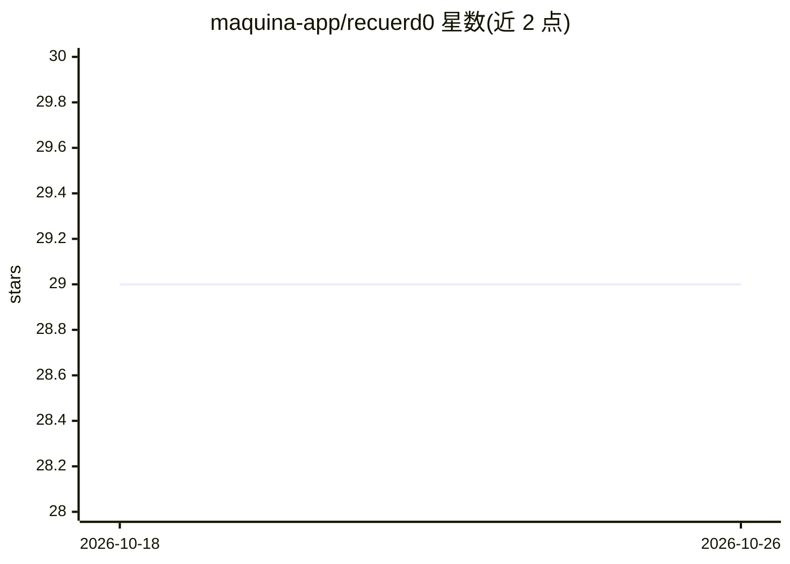

# maquina-app/recuerd0

⭐ 29 · Ruby · NOASSERTION · 推送 2026-10-17 · [GitHub](https://github.com/maquina-app/recuerd0) · [官网](https://recuerd0.ai) · 个人维护

**自托管 Web 应用：保存、版本化并组织 AI 对话中的知识**

用 Ruby on Rails（Rails 8.1 + SQLite + Hotwire）编写的可自托管知识管理应用：将来自 AI 对话的记忆以 Markdown 形式存入工作区，提供全文搜索（FTS5，支持 AND/OR/NOT 与短语匹配）、版本分支与对比、REST API（Bearer token 认证、只读/完全两级权限）、置顶、多用户与单/多租户模式。用于构建跨会话、跨工具、跨模型的持久知识库。提供 Docker 自托管方式与托管版 recuerd0.ai；无 Node.js、Redis 等外部服务依赖。许可为 OSaaS（MIT + No Competing SaaS）。

## 筛选速览

| 维度 | 判定 | 备注 |
|---|---|---|
| AI 角色 | `ai-ecosystem` | LLM/agent 周边工具 |
| 许可风险 | `none` | NOASSERTION |
| 部署形态 | `self-host` | docker 或自建部署 |
| 模型依赖 | — | README 未给出锁定关系 |
| 硬件要求 | — | 无带数字的原话,不猜 |
| 安装摩擦 | `low` | 无编译、无系统依赖或容器化 |
| 成熟度 | — | 结构信号不足 |

## 能力要点

- Markdown 记忆按工作区组织，支持归档与软删除
- FTS5 全文搜索（AND/OR/NOT、短语匹配、列过滤）
- 记忆版本化：任意版本分支、历史对比、合并
- REST API（Bearer token、只读/完全两级权限）与多用户/多租户

## 适用场景

- 让 LLM 对话中积累的知识跨会话和跨模型保留
- 团队共享通过 REST API 管理的记忆库
- 自托管一个可版本追溯的 AI 知识工作区

## 场景标签

`知识库管理` · 领域:知识与检索

## 证据(README 行号)

> L9: recuerd0 is a self-hostable web application for managing knowledge extracted from AI conversations. It stores Markdo
> L11: Use it to build a persistent knowledge base from your interactions with LLMs -- so context survives across sessions

## 星数曲线

2026-10-18 29 → 2026-10-26 29（+0）

---
*卡片 v1 · prompt 1.4 · 生成 2026-10-26 · 置信度 high · 依据 README sha `02f33b59cdc0` · [字段定义](../../DATASET.md)*
