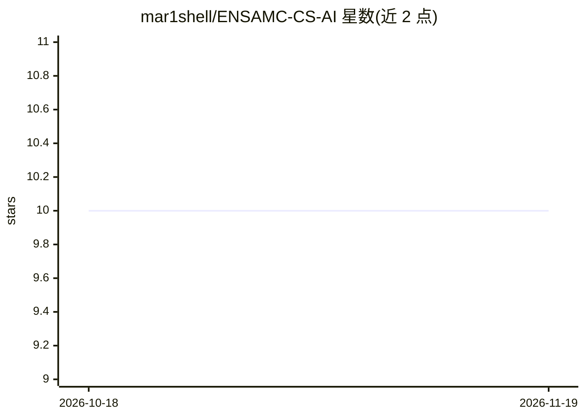

# mar1shell/ENSAMC-CS-AI

⭐ 10 · Jupyter Notebook · 推送 2026-06-11 · [GitHub](https://github.com/mar1shell/ENSAMC-CS-AI) · 个人维护

**ENSAM 卡萨布兰卡计算机科学与 AI 专业的课程资料仓库**

按学期组织的课程资料 monorepo，收录 ENSAM Casablanca 计算机科学与人工智能专业五年内的课程、项目与笔记，覆盖 Python/Java 编程、数据库、操作系统、算法、网络、Web 开发、数据分析、云计算、机器学习与文本挖掘、AR/VR、计算机视觉与生成式 AI 等科目，含共享的书籍、教程与链接资源文件夹。仅整理课程内容，不含可运行的产品或安装流程。

## 筛选速览

| 维度 | 判定 | 备注 |
|---|---|---|
| AI 角色 | `ai-knowledge` | 知识聚合/清单类 |
| 许可风险 | `none` | — |
| 部署形态 | `None` |  |
| 模型依赖 | — | README 未给出锁定关系 |
| 硬件要求 | — | 无带数字的原话,不猜 |
| 安装摩擦 | `low` | 无编译、无系统依赖或容器化 |
| 成熟度 | — | 结构信号不足 |

## 能力要点

- 按 5 个学期分科目的课程资料组织结构
- 覆盖编程、数据库、AI/机器学习、AR/VR 等多领域课程
- 包含生成式 AI、自主机器人等 AI 方向选修课程
- 提供共享资源文件夹（书籍、教程、链接）

## 适用场景

- 查找 ENSAM Casablanca 同专业各学期的课程与项目材料
- 参考计算机科学与 AI 专业的课程设置
- 获取数据结构与算法、数据库等科目的共享资料

## 场景标签

`教程课程` · 领域:学习与行业

## 证据(README 行号)

> L7: This repository contains all my coursework, projects, and notes throughout my Computer Science and Artificial Intell
> L11: This monorepo is organized by semester. Each semester contains individual repositories for the respective subjects:

## 星数曲线

2026-10-18 10 → 2026-11-19 10（+0）

---
*卡片 v1 · prompt 1.4 · 生成 2026-11-19 · 置信度 high · 依据 README sha `281639795080` · [字段定义](../../DATASET.md)*
