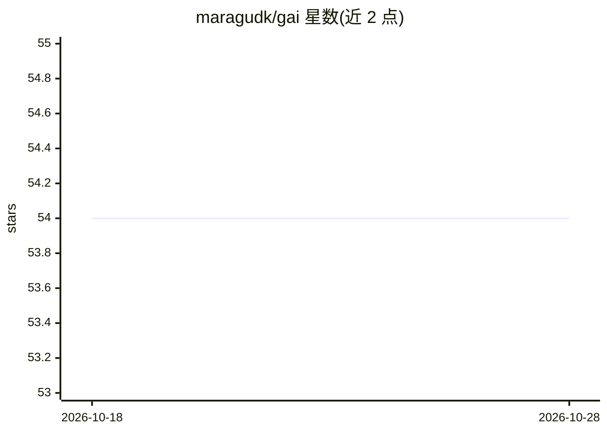

# maragudk/gai

⭐ 54 · Go · MIT · 推送 2026-10-27 · [GitHub](https://github.com/maragudk/gai) · [官网](https://gai.maragu.dev) · 个人维护

**Go 语言 AI 库：统一接口调用各家 LLM 并做模型评测**

面向 Go 开发者的 AI 库，提供 OpenAI、Google、Anthropic 三种客户端实现，支持工具（tool）调用与自定义工具的对话流程。内置评测（evals）机制：通过 go test 运行样例，使用词法相似度与语义相似度打分器评分，结果输出到 evals.jsonl，并支持多模态图像描述评测。文档给出 GAI 概念与各厂商 SDK 术语的映射表。README 声明库处于开发中，已有功能可用但可能变更。

## 筛选速览

| 维度 | 判定 | 备注 |
|---|---|---|
| AI 角色 | `ai-ecosystem` | LLM/agent 周边工具 |
| 许可风险 | `permissive` | MIT |
| 部署形态 | `None` |  |
| 模型依赖 | — | README 未给出锁定关系 |
| 硬件要求 | — | 无带数字的原话,不猜 |
| 安装摩擦 | `low` | 无编译、无系统依赖或容器化 |
| 成熟度 | `idea` | |

## 能力要点

- OpenAI/Google/Anthropic 客户端实现
- 工具调用与自定义工具示例
- 评测框架：词法与语义相似度打分，输出 evals.jsonl
- 多模态图像描述评测
- GAI 概念与各家 SDK 的术语映射表

## 适用场景

- 在 Go 项目中以统一接口调用不同厂商的 LLM
- 为模型构建带工具调用的对话程序
- 用 go test 跑模型评测并记录结果

## 场景标签

`模型评测` `模型网关` · 领域:Agent 开发

## 证据(README 行号)

> L8: Go Artificial Intelligence (GAI) helps you work with foundational models, large language models, and other AI models
> L66: Evals will only run with `go test -run TestEval ./...` and otherwise be skipped.

## 星数曲线

2026-10-18 54 → 2026-10-28 54（+0）

---
*卡片 v1 · prompt 1.4 · 生成 2026-10-24 · 置信度 high · 依据 README sha `cfd7f590bce2` · [字段定义](../../DATASET.md)*
