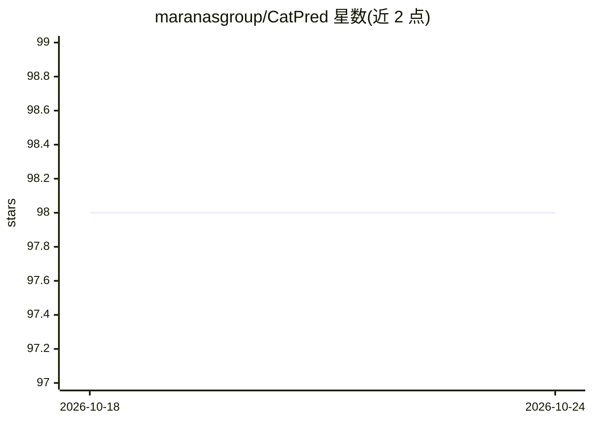

# maranasgroup/CatPred

⭐ 98 · Python · MIT · 推送 2026-06-15 · [GitHub](https://github.com/maranasgroup/CatPred) · [官网](https://www.catpred.com) · 组织维护

**深度学习预测体外酶动力学参数（kcat/Km/Ki）的框架**

基于 PyTorch 的酶动力学参数预测框架，覆盖底物动力学（kcat、Km）与抑制（Ki）两类预测任务。提供预训练模型下载、训练脚本与三种复现论文结果的途径（快速复现约数分钟、预测最长一天、训练需 12-14 天）。使用方式包括 www.catpred.com 网页版、Google Colab、本地 conda 安装、Docker 镜像及可选 FastAPI 服务（可本地或 Modal 后端推理，支持 Vercel 部署）。输入需 SMILES、序列与 pdbpath 列的 CSV；多链蛋白复合物未在默认工作流中单独建模。发表于 Nature Communications。

## 筛选速览

| 维度 | 判定 | 备注 |
|---|---|---|
| AI 角色 | `ai-native` | 本体是模型或模型工具 |
| 许可风险 | `permissive` | MIT |
| 部署形态 | `self-host` | docker 或自建部署 |
| 模型依赖 | — | README 未给出锁定关系 |
| 硬件要求 | — | 无带数字的原话,不猜 |
| 安装摩擦 | `low` | 无编译、无系统依赖或容器化 |
| 成熟度 | — | 结构信号不足 |

## 能力要点

- 预训练模型预测 kcat、Km、Ki 三类动力学参数
- 提供 Web App、Colab、本地安装与 Docker 四种使用途径
- 可选 FastAPI 服务，支持本地/Modal 后端与 Vercel 部署
- 三种脚本复现论文全部主图与补充图结果

## 适用场景

- 输入酶序列与底物 SMILES 预测 kcat、Km、Ki 参数
- 批量 CSV 预测并导出结果用于酶工程筛选
- 从头训练或复现论文中的模型与图表

## 场景标签

 · 领域:计算生物学/酶工程

## 证据(README 行号)

> L1: # CatPred: A Comprehensive Framework for Deep Learning In Vitro Enzyme Kinetic Parameters
> L23: - **Two prediction modes:** Substrate kinetics (kcat/Km) and Inhibition (Ki)

## 星数曲线

2026-10-18 98 → 2026-10-24 98（+0）

---
*卡片 v1 · prompt 1.4 · 生成 2026-10-23 · 置信度 mid · 依据 README sha `bb68db494cfa` · [字段定义](../../DATASET.md)*
