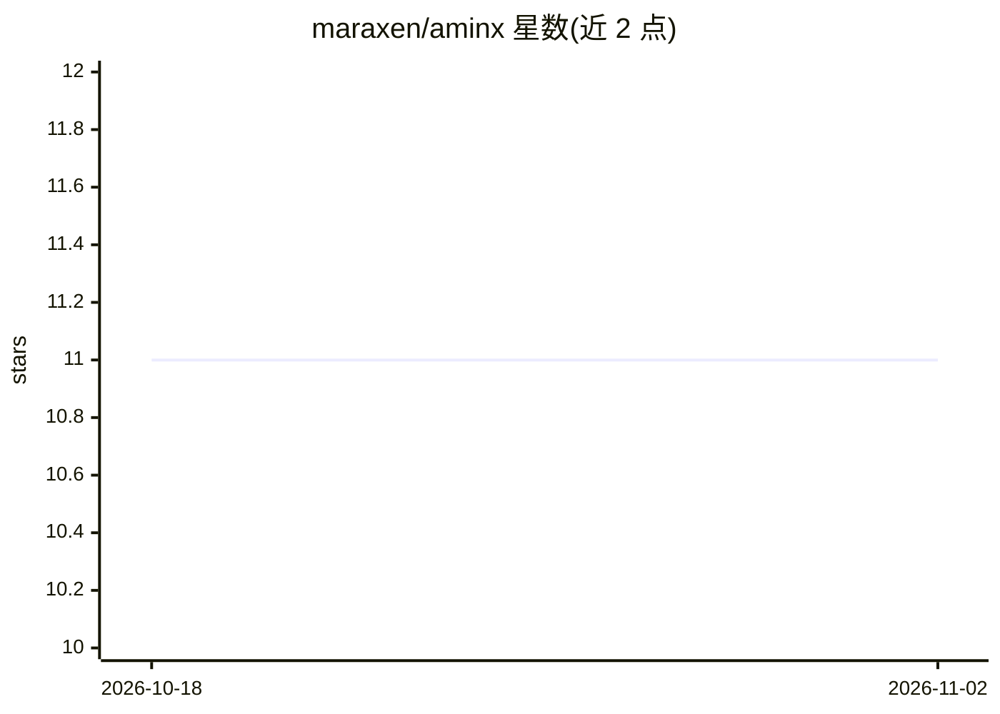

# maraxen/aminx

⭐ 11 · Python · MIT · 推送 2026-10-30 · [GitHub](https://github.com/maraxen/aminx) · [官网](https://maraxen.github.io/aminx/) · 个人维护

**JAX/Equinox 重实现的 ProteinMPNN/LigandMPNN 蛋白序列设计库**

用 JAX/Equinox 重新实现 LigandMPNN 代码库，提供函数式 sample()/score() API 与可组合推理层 StageSet，支持温度数组、混合长度批处理与去重评分等原生批处理模式。面向蛋白质设计研究者与开发者。README 明确声明处于 Beta 实验阶段：与上游 LigandMPNN 参考实现的数值一致性审计目前为全局 FAIL，ligand、membrane 等路径存在已确认缺陷，packer 路径未实现；通过 uv 或 pip 安装，提供 Python API 与 Typer CLI。

## 筛选速览

| 维度 | 判定 | 备注 |
|---|---|---|
| AI 角色 | `ai-native` | 本体是模型或模型工具 |
| 许可风险 | `permissive` | MIT |
| 部署形态 | `library` | 以包/库形式分发 |
| 模型依赖 | — | README 未给出锁定关系 |
| 硬件要求 | `cpu-ok` | |
| 安装摩擦 | `medium` | 含编译或系统依赖之一 |
| 成熟度 | `idea` | |

## 能力要点

- 函数式 sample()/score() API，无需组装模型对象或编写推理循环
- 温度数组、混合长度批、DedupGather 去重评分等 JIT 编译批处理模式
- 对上游 LigandMPNN 的逐路径数值一致性审计（当前全局判定 FAIL）
- Typer CLI 覆盖 run/campaign/spec 命令组，支持 ProteinMPNN/LigandMPNN/PottsMPNN/LASErMPNN

## 适用场景

- 在 JAX 生态中运行 ProteinMPNN/LigandMPNN 采样与打分
- 批量扫描温度或评分混合长度蛋白库
- 通过 CLI 快速执行采样打分流水线

## 场景标签

`科研工具` · 领域:学习与行业

## 证据(README 行号)

> L12: Aminx is a JAX/Equinox reimplementation of the LigandMPNN codebase. A graded literature-parity audit against Ligand
> L16: - A functional `sample()` / `score()` API — no model objects to wire up, no inference loop to write.
> L222: `--model-family` selects the inference family. `proteinmpnn` and `ligandmpnn` run

## 星数曲线

2026-10-18 11 → 2026-11-02 11（+0）

---
*卡片 v1 · prompt 1.4 · 生成 2026-11-02 · 置信度 high · 依据 README sha `102077bd8b08` · [字段定义](../../DATASET.md)*
