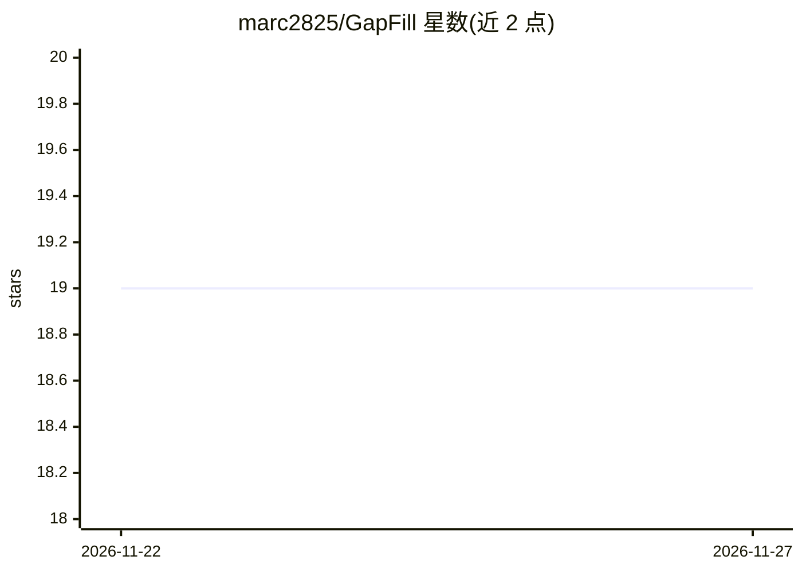

# marc2825/GapFill

⭐ 19 · Python · MIT · 推送 2026-11-17 · [GitHub](https://github.com/marc2825/GapFill) · 组织维护

**面向动画上色师的塗り残し检测与填色建议工具**

GapFill 是面向职业动画上色师的交互式工具，用于检测并填补数字手工上色中遗留的小型未上色封闭区域（塗り残し/gaps）。系统自动检测间隙并高亮，用领域特定的深度学习方法学习图像区域间对应关系后给出填色建议；另提供弹出放大、手动改色、扫动应用等交互。仓库含 Web 应用、Krita 插件与机器学习管线三个组件；训练数据与部分素材因版权不随仓库分发，模型经论文提交后重新训练，预测结果与用户研究版本略有差异。

## 筛选速览

| 维度 | 判定 | 备注 |
|---|---|---|
| AI 角色 | `ai-native` | 本体是模型或模型工具 |
| 许可风险 | `permissive` | MIT |
| 部署形态 | `None` |  |
| 模型依赖 | — | README 未给出锁定关系 |
| 硬件要求 | — | 无带数字的原话,不猜 |
| 安装摩擦 | `low` | 无编译、无系统依赖或容器化 |
| 成熟度 | — | 结构信号不足 |

## 能力要点

- 自动检测未上色封闭区域并高亮、给出填色建议
- Krita 插件提供模型辅助预览与画布交互
- 组件化仓库：Web 应用 / Krita 插件 / ML 训练管线
- 发布版模型重训练后精度较论文版本有提升

## 适用场景

- 动画上色流程中查找并填补塗り残し
- 在 Krita 画布中借助模型预览进行上色检查
- 复现或扩展论文中的间隙检测模型与训练管线

## 场景标签

`图像视频处理` `目标检测` · 领域:感知与多模态

## 证据(README 行号)

> L14: **GapFill** is an interactive tool for helping professional anime colorists
> L18: The system automatically detects gaps, highlights them, and suggests fill
> L19: colors using a domain-specific deep-learning method that learns

## 星数曲线

2026-11-22 19 → 2026-11-27 19（+0）

---
*卡片 v1 · prompt 1.4 · 生成 2026-11-22 · 置信度 high · 依据 README sha `3499f8f464ce` · [字段定义](../../DATASET.md)*
