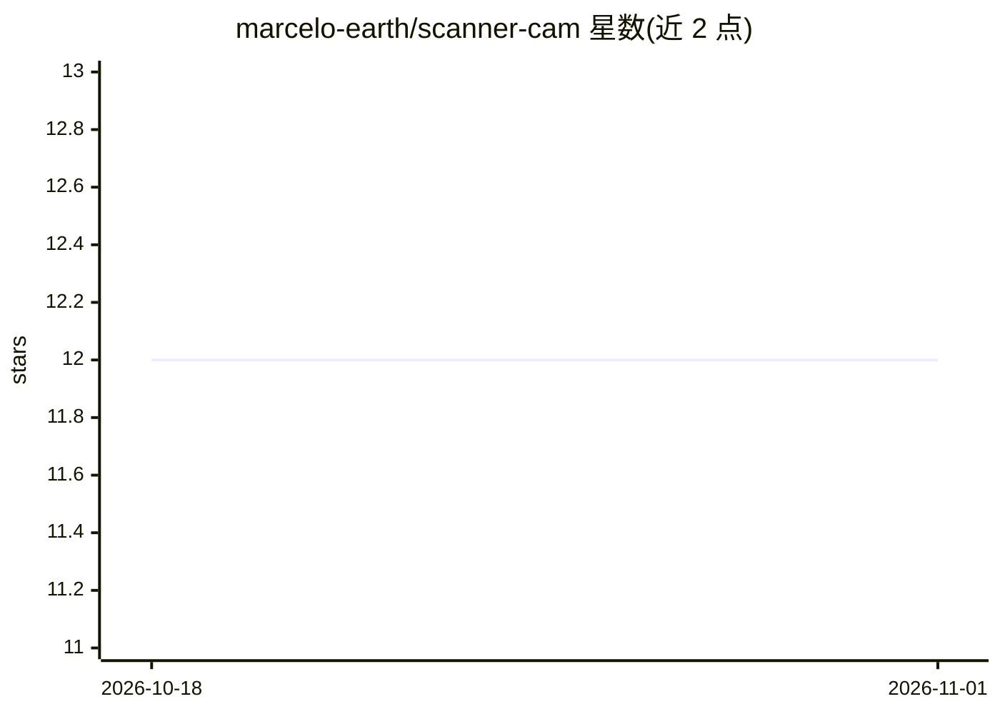

# marcelo-earth/scanner-cam

⭐ 12 · TypeScript · MIT · 推送 2026-07-22 · [GitHub](https://github.com/marcelo-earth/scanner-cam) · [官网](https://scannercam.astronware.com) · 个人维护

**浏览器端实时物体识别 Web 应用，检测到物体可语音播报**

基于 Next.js/React/TypeScript 的 Web 应用：将设备摄像头画面实时送入 TensorFlow.js 的 COCO-SSD 模型，检测最多 80 类常见物体，并可通过 Speech Synthesis API 语音播报检测结果（object-to-voice）。模型首次从 TensorFlow.js Hub 下载后缓存于浏览器，此后可离线运行。支持英文/西班牙语国际化与明暗主题，UI 用 TailwindCSS 构建，测试用 Playwright，部署于 Vercel。

## 筛选速览

| 维度 | 判定 | 备注 |
|---|---|---|
| AI 角色 | `ai-native` | 本体是模型或模型工具 |
| 许可风险 | `permissive` | MIT |
| 部署形态 | `None` |  |
| 模型依赖 | — | README 未给出锁定关系 |
| 硬件要求 | — | 无带数字的原话,不猜 |
| 安装摩擦 | `low` | 无编译、无系统依赖或容器化 |
| 成熟度 | — | 结构信号不足 |

## 能力要点

- 摄像头帧实时送入 TensorFlow.js COCO-SSD 模型检测最多 80 类物体
- 模型缓存于浏览器，首次加载后可离线工作
- Speech Synthesis API 语音播报检测到的物体
- 英文/西班牙语国际化与明暗主题，Playwright 持续测试

## 适用场景

- 用手机或电脑摄像头实时识别眼前的常见物体
- 离线状态下继续使用物体检测
- 通过语音播报获知检测到的物体，辅助视觉场景感知

## 场景标签

`目标检测` · 领域:感知与多模态

## 证据(README 行号)

> L20: ScannerCam is a web application that uses the TensorFlow.js computer vision library to detect objects in real time 
> L35: **ScannerCam** is a web application that contains a camera module (capable of reverting to environment camera and f

## 星数曲线

2026-10-18 12 → 2026-11-01 12（+0）

---
*卡片 v1 · prompt 1.4 · 生成 2026-11-01 · 置信度 high · 依据 README sha `9f6bd9e78fae` · [字段定义](../../DATASET.md)*
