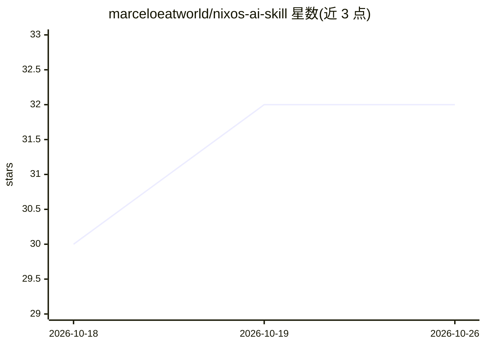

# marceloeatworld/nixos-ai-skill

⭐ 32 · Shell · 推送 2026-10-25 · [GitHub](https://github.com/marceloeatworld/nixos-ai-skill) · 个人维护

**NixOS/Nix 文档的 AI 编程助手技能包，日更自动生成**

为 33+ 款 AI 编程助手（Claude Code、Cursor、Windsurf、GitHub Copilot、Codex、Gemini CLI 等）提供 NixOS 与 Nix 官方文档的知识技能包：基于开放 Agent Skills 标准（SKILL.md），每日由 GitHub Actions 从 nix.dev、nixpkgs 手册、nix-pills、release-wiki 四个官方仓库自动重新生成参考文件。SKILL.md 充当路由表，将主题映射到参考文件并提供在线获取的回退 URL；references/ 目录存放完整未修改的原始文档。安装方式为 git clone 到各工具的技能目录或使用安装脚本。

## 筛选速览

| 维度 | 判定 | 备注 |
|---|---|---|
| AI 角色 | `ai-knowledge` | 知识聚合/清单类 |
| 许可风险 | `none` | — |
| 部署形态 | `None` |  |
| 模型依赖 | — | README 未给出锁定关系 |
| 硬件要求 | — | 无带数字的原话,不猜 |
| 安装摩擦 | `low` | 无编译、无系统依赖或容器化 |
| 成熟度 | — | 结构信号不足 |

## 能力要点

- 每日由 GitHub Actions 从四个官方 NixOS 仓库自动重新生成
- 基于开放 Agent Skills 标准，兼容 33+ AI 编程工具
- SKILL.md 作为主题路由表，references/ 存放完整原始文档而非摘要
- 提供多工具安装脚本与手动再生脚本

## 适用场景

- 让 AI 编程助手准确回答 NixOS 配置与 Nix 语言问题
- 在 Cursor/Claude Code 等工具中获取最新官方 Nix 文档上下文
- 通过 git pull 持续更新本地文档引用

## 场景标签

 · 领域:开发运维/文档知识

## 证据(README 行号)

> L3: Auto-updated NixOS and Nix documentation for AI coding assistants.
> L5: Uses the open Agent Skills standard (SKILL.md). Works with **33+ AI coding assistants** including Claude Code, Curso

## 星数曲线

2026-10-18 30 → 2026-10-26 32（+2）

---
*卡片 v1 · prompt 1.4 · 生成 2026-10-26 · 置信度 high · 依据 README sha `828b9928647b` · [字段定义](../../DATASET.md)*
