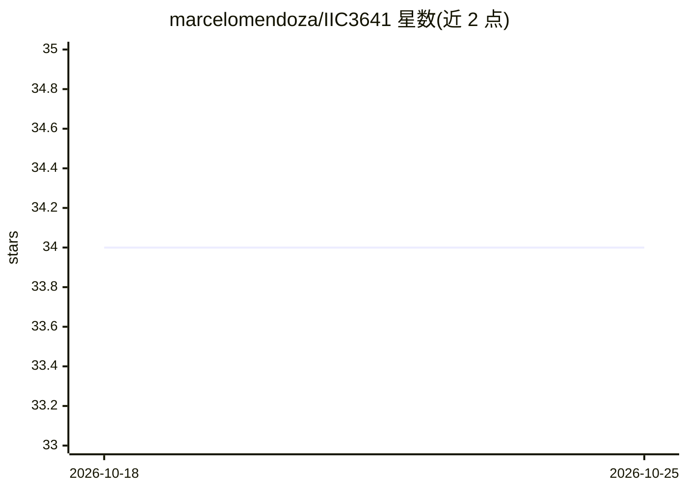

# marcelomendoza/IIC3641

⭐ 34 · Jupyter Notebook · MIT · 推送 2026-10-19 · [GitHub](https://github.com/marcelomendoza/IIC3641) · 组织维护

**智利大学图机器学习课程（IIC3641）的 Python 代码与示例集**

智利大学（Pontificia Universidad Católica 课程编号 IIC3641）图机器学习（Graph-based Machine Learning）课程的配套代码与示例仓库，由教师 Marcelo Mendoza 与四位助教维护，2026/2 学期，每周一 3-4 节在 BC22 教室上课。README 仅给出课程与人员信息，未提供安装说明或具体代码内容描述，主题标签涉及深度学习、图神经网络、网络科学等。

## 筛选速览

| 维度 | 判定 | 备注 |
|---|---|---|
| AI 角色 | `ai-knowledge` | 知识聚合/清单类 |
| 许可风险 | `permissive` | MIT |
| 部署形态 | `None` |  |
| 模型依赖 | — | README 未给出锁定关系 |
| 硬件要求 | — | 无带数字的原话,不猜 |
| 安装摩擦 | `low` | 无编译、无系统依赖或容器化 |
| 成熟度 | — | 结构信号不足 |

## 能力要点

- 图机器学习课程的 Python 代码与示例
- 由教师与四位助教维护
- 2026/2 学期课程配套材料

## 适用场景

- 修课学生获取课程示例代码
- 自学图神经网络与网络科学参考课程材料

## 场景标签

`教程课程` · 领域:学习与行业

## 证据(README 行号)

> L1: # IIC3641 - GML
> L2: Códigos y ejemplos en Python del curso GML (Graph-based Machine Learning)

## 星数曲线

2026-10-18 34 → 2026-10-25 34（+0）

---
*卡片 v1 · prompt 1.4 · 生成 2026-10-25 · 置信度 mid · 依据 README sha `622e6805e8d9` · [字段定义](../../DATASET.md)*
