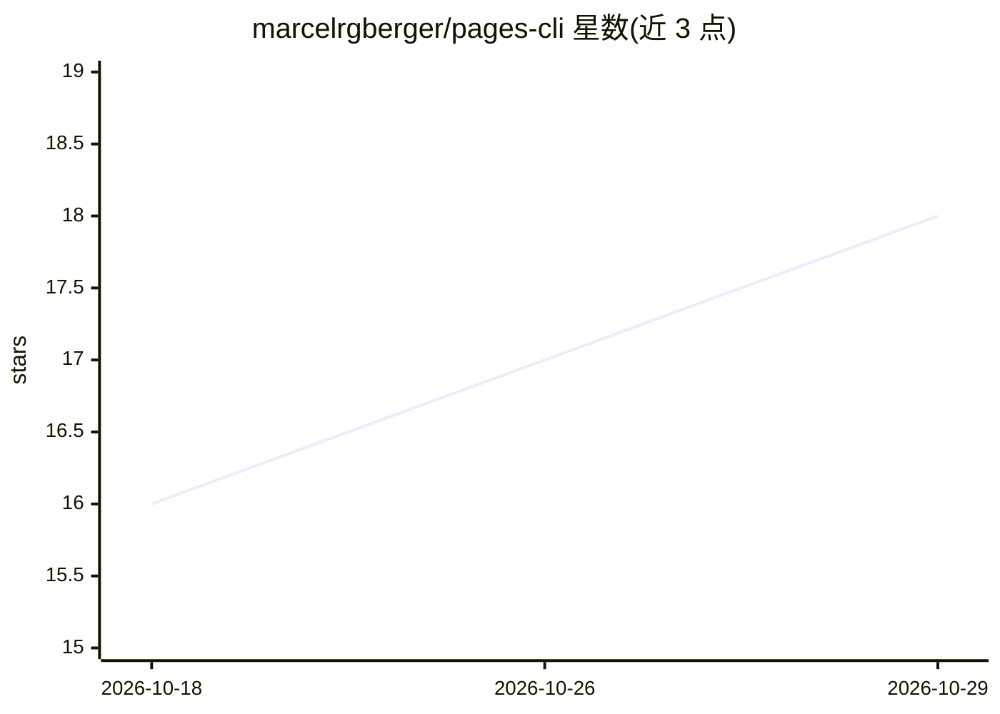

# marcelrgberger/pages-cli

⭐ 18 · Python · MIT · 推送 2026-10-15 · [GitHub](https://github.com/marcelrgberger/pages-cli) · 个人维护

**Claude Code 插件：通过自然语言/命令操控 Apple Pages 文档**

面向 Claude Code 的 Apple Pages 控制插件：以 CLI 后端通过 osascript 调用 Pages 原生 AppleScript API，覆盖文档创建（100+ 模板）、文本/表格/媒体编辑、密码保护及 PDF/Word/EPUB 等多格式导出，并声明覆盖 Pages 脚本定义的全部命令与属性。提供 /pages 斜杠命令、CLI 与 REPL 模式，所有命令带 --json 输出便于 agent 集成。要求 macOS、已安装 Apple Pages、Python 3.10+ 与 Claude Code CLI；CLI 本身是接口而非 Pages 替代品。

## 筛选速览

| 维度 | 判定 | 备注 |
|---|---|---|
| AI 角色 | `ai-ecosystem` | LLM/agent 周边工具 |
| 许可风险 | `permissive` | MIT |
| 部署形态 | `library` | 以包/库形式分发 |
| 模型依赖 | — | README 未给出锁定关系 |
| 硬件要求 | — | 无带数字的原话,不猜 |
| 安装摩擦 | `low` | 无编译、无系统依赖或容器化 |
| 成熟度 | — | 结构信号不足 |

## 能力要点

- 声明覆盖 Pages AppleScript API 全部命令、类、属性与枚举
- 导出 PDF/Word/EPUB/RTF/plain text/Pages 09，支持密码与图片质量选项
- 100+ 模板创建与占位符填充，表格含公式、合并、排序、区域样式
- 全部命令支持 --json 输出，提供 REPL 模式与状态跟踪

## 适用场景

- 让 Claude Code 直接创建和编辑 Pages 文档
- 用自然语言排版报告并导出 PDF/Word/EPUB
- 在自动化流程中批量填充模板与表格数据

## 场景标签

`GUI 自动化` · 领域:效率与自动化

## 证据(README 行号)

> L3: Claude Code plugin for full programmatic control over **Apple Pages**. Create, edit, format, and export Pages docume
> L23: - **Claude Code** CLI (for plugin usage)
> L172:     U[User / Claude] -->|/pages command| CLI[pages-cli]

## 星数曲线

2026-10-18 16 → 2026-10-29 18（+2）

---
*卡片 v1 · prompt 1.4 · 生成 2026-10-29 · 置信度 high · 依据 README sha `cfc7db494678` · [字段定义](../../DATASET.md)*
