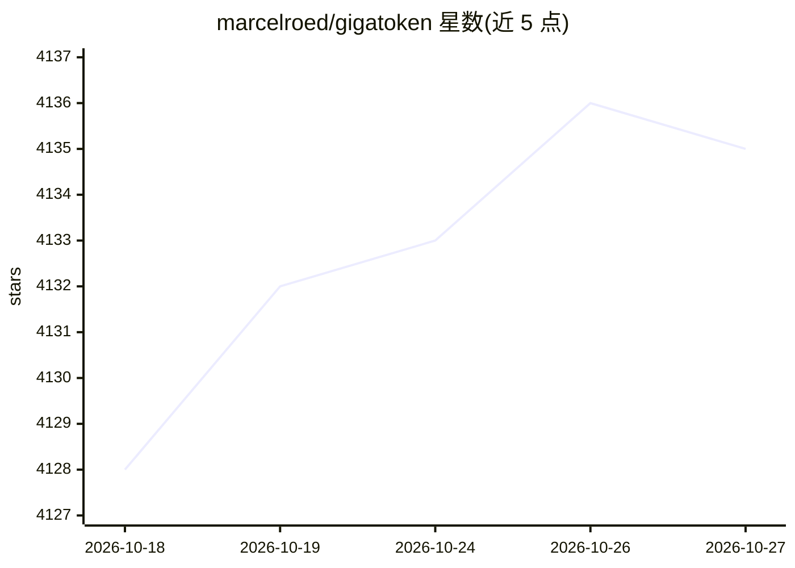

# marcelroed/gigatoken

⭐ 4,135 · Rust · MIT · 推送 2026-09-02 · [GitHub](https://github.com/marcelroed/gigatoken) · 个人维护

**面向语言建模的高速分词库，宣称 GB/s 级编码吞吐**

以 Rust 实现的 BPE 分词库，通过 SIMD 优化的预分词与预分词映射缓存、最小化 Python 交互与线程间通信提升编码吞吐。提供自有 Gigatoken API（Rust 直接读文件、并行分词）以及与 HuggingFace Tokenizers/Tiktoken 的兼容模式（力求输出一致但有性能损耗）。支持 GPT-2、Llama、Qwen、DeepSeek、GLM、Gemma 等常见 BPE 词表，SentencePiece/WordPiece 未充分支持。pip 安装，带 CLI 基准验证命令。已知限制：Windows 测试少（建议 WSL）、CJK 数据分词明显较慢。

## 筛选速览

| 维度 | 判定 | 备注 |
|---|---|---|
| AI 角色 | `ai-ecosystem` | LLM/agent 周边工具 |
| 许可风险 | `permissive` | MIT |
| 部署形态 | `library` | 以包/库形式分发 |
| 模型依赖 | — | README 未给出锁定关系 |
| 硬件要求 | — | 无带数字的原话,不猜 |
| 安装摩擦 | `low` | 无编译、无系统依赖或容器化 |
| 成熟度 | — | 结构信号不足 |

## 能力要点

- Rust 实现配合 SIMD 预分词与缓存层级，多 CPU（x86/ARM）基准数据公开
- 兼容模式输出与 HuggingFace Tokenizers 对齐，可作 drop-in replacement
- 支持 GPT-2/Llama/Qwen/DeepSeek/GLM 等常见 BPE 词表，接受 HF 模型名
- CLI bench 命令可免安装验证并计时给定 HF 模型仓库

## 适用场景

- 大规模语料（如 CommonCrawl 级文本）训练前的高速分词预处理
- 从 HuggingFace tokenizers/tiktoken 迁移且需输出一致的场景
- 验证自己的 tokenizer 是否受支持并测量吞吐

## 场景标签

 · 领域:LLM 基础设施/数据预处理

## 证据(README 行号)

> L12: Gigatoken is the fastest tokenizer for language modeling.
> L41: tokens = tokenizer.encode_files(file_source)

## 星数曲线

2026-10-18 4,128 → 2026-10-27 4,135（+7）

---
*卡片 v1 · prompt 1.4 · 生成 2026-10-21 · 置信度 high · 依据 README sha `90bbe91e33cc` · [字段定义](../../DATASET.md)*
