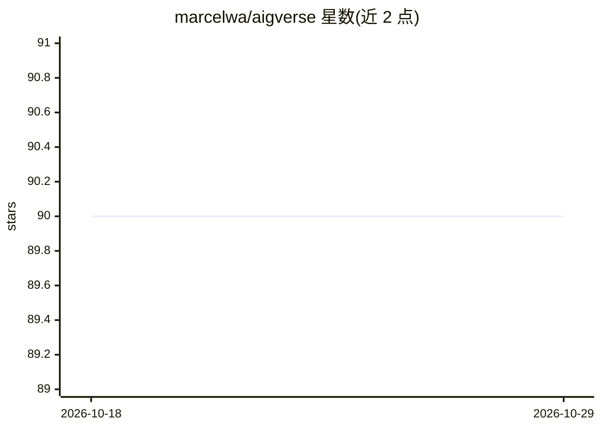

# marcelwa/aigverse

⭐ 90 · Python · MIT · 推送 2026-10-27 · [GitHub](https://github.com/marcelwa/aigverse) · [官网](https://aigverse.readthedocs.io/) · 个人维护

**Python 逻辑综合库：AIG 构造、优化与 ML 工作流互操作**

基于 nanobind 封装 EPFL Logic Synthesis Libraries（mockturtle、kitty、lorina）的 Python 库，提供 And-Inverter Graph（AIG）的构造、操作、逻辑优化（resubstitution/refactoring/rewriting/balancing）、SAT 等价性检查、随机与结构化 AIG 生成、基准电路按需下载，以及 AIGER/Verilog/PLA 等格式的读写。可选安装 adapters 扩展以导出 NetworkX 图与 NumPy 数组，供下游数据科学与机器学习流水线使用；也可桥接已安装的 ABC 可执行文件运行优化脚本。项目处于早期开发阶段，API 可能变动。

## 筛选速览

| 维度 | 判定 | 备注 |
|---|---|---|
| AI 角色 | `ai-enhanced` | 去掉 AI 部分产品仍成立 |
| 许可风险 | `permissive` | MIT |
| 部署形态 | `library` | 以包/库形式分发 |
| 模型依赖 | — | README 未给出锁定关系 |
| 硬件要求 | — | 无带数字的原话,不猜 |
| 安装摩擦 | `low` | 无编译、无系统依赖或容器化 |
| 成熟度 | `idea` | |

## 能力要点

- 封装 EPFL C++ 综合库，提供 Pythonic 的 AIG 操作与优化接口
- 读写 AIGER/Verilog/PLA/Bench 格式，支持与其他综合工具互操作
- 可选 adapters 导出 NetworkX 图与 NumPy 数组，接入 ML 流水线
- 按需下载并缓存 EPFL 基准电路套件，支持 SAT 等价性检查与 ABC 桥接

## 适用场景

- 在 Python 中构建、优化与验证逻辑电路（AIG）
- 生成 AIG 数据集并导出为图/数组表示用于机器学习实验
- 复现和评测逻辑综合基准电路上的优化算法

## 场景标签

 · 领域:电子设计自动化（EDA）/逻辑综合

## 证据(README 行号)

> L20: `aigverse` is an open-source infrastructure project that brings mature logic synthesis capabilities into
> L41: - **ML/Data Science Interoperability**: Optional adapters for graph and array representations used in Python data
> L288: ### 🧠 Machine Learning Integration

## 星数曲线

2026-10-18 90 → 2026-10-29 90（+0）

---
*卡片 v1 · prompt 1.4 · 生成 2026-10-23 · 置信度 mid · 依据 README sha `26ea6517c540` · [字段定义](../../DATASET.md)*
