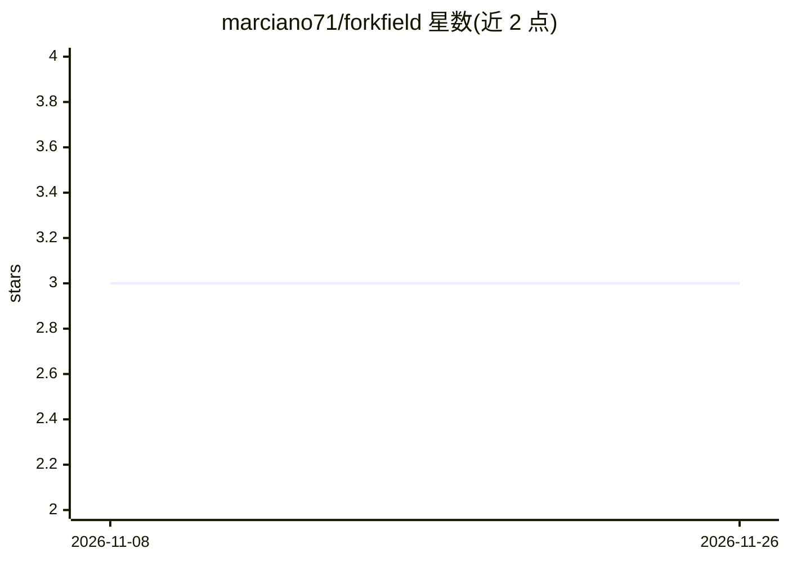

# marciano71/forkfield

⭐ 3 · JavaScript · MIT · 推送 2026-10-29 · [GitHub](https://github.com/marciano71/forkfield) · 组织维护

**把任意视频效果做成可分叉配方并生成个人视频的工具**

基于 ComfyUI 的视频效果复刻工具：生成的每个 MP4 在 comment 标签内以 base64(JSON) 携带完整配方，他人在 Forkfield 中放入该片段即可用自己的照片复现同一效果。对无配方的外部视频，浏览器提取首中尾三帧、由 Qwen3-VL 生成配方描述。生成链路为 Qwen-Image-Edit 2511（Lightning LoRA）绘制末帧、LTX-2.5 22B distilled 生成带音频视频。需 Node 20+ 与 ffmpeg，支持 Comfy Cloud 或本地 ComfyUI（约 24 GB+ GPU），亦可切换 partner 引擎按次计费。

## 筛选速览

| 维度 | 判定 | 备注 |
|---|---|---|
| AI 角色 | `ai-native` | 本体是模型或模型工具 |
| 许可风险 | `permissive` | MIT |
| 部署形态 | `None` |  |
| 模型依赖 | — | README 未给出锁定关系 |
| 硬件要求 | — | 无带数字的原话,不猜 |
| 安装摩擦 | `medium` | 含编译或系统依赖之一 |
| 成熟度 | — | 结构信号不足 |

## 能力要点

- 视频文件内嵌配方（ffprobe 可读取），支持分叉与二次发布
- Qwen3-VL 读取任意视频首中尾帧自动生成效果配方
- Qwen-Image-Edit + LTX-2.5 全开放权重生成链路，单一 ComfyUI 工作流完成
- 支持 Comfy Cloud、本地 GPU、无 GPU partner 引擎三种运行方式

## 适用场景

- 把自己照片套用他人分享的视频效果
- 对外部视频提取效果配方并复现
- 编辑配方后分享，形成效果分叉树

## 场景标签

`视频生成` · 领域:内容生成

## 证据(README 行号)

> L20: 2. **Qwen3-VL 8B** (open weights, running in ComfyUI's `TextGenerate` node) looks at those frames and writes a reci
> L35: **100% open weights. No partner nodes, no closed APIs.** One ComfyUI graph does it all: `workflows/forkfield_open.a
> L61: - **Your own ComfyUI** with a ~24 GB+ GPU and the models listed below in `models/`.

## 星数曲线

2026-11-08 3 → 2026-11-26 3（+0）

---
*卡片 v1 · prompt 1.4 · 生成 2026-11-26 · 置信度 high · 依据 README sha `27808a26bf27` · [字段定义](../../DATASET.md)*
