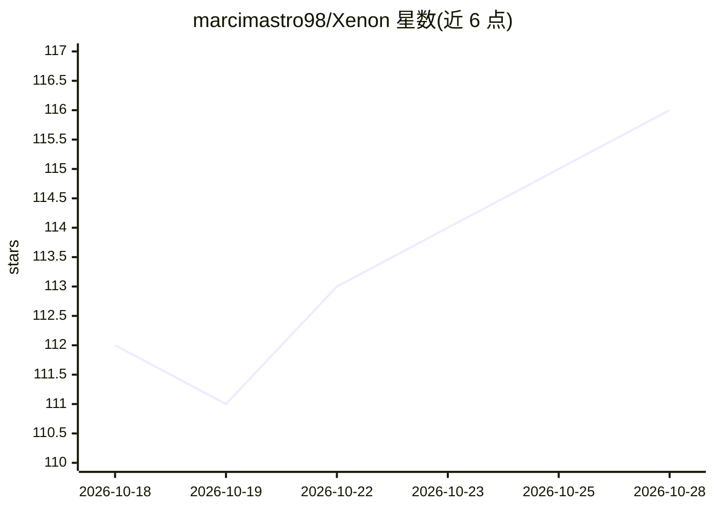

# marcimastro98/Xenon

⭐ 116 · JavaScript · NOASSERTION · 推送 2026-10-26 · [GitHub](https://github.com/marcimastro98/Xenon) · [官网](https://xenon-app.com/) · 个人维护

**本地全功能第二屏仪表盘：系统监控、媒体、AI 助手与外设控制**

把备用屏幕/平板/手机变成 PC 控制中心的本地 Web 应用，提供原生全屏应用、浏览器标签与配对手机等五种呈现方式。功能覆盖系统与网络监控、媒体与音频控制、通知中心、来电卡片、Stream Deck 式按键格（Deck）、RGB 灯光桥接、Twitch/OBS 控制、日历任务等。内置语音+视觉+聊天 AI 助手（Xenon AI），可用本地 "Hey Xenon" 唤醒词启动，后端可选 Google Gemini（云）或 Ollama（本地），还能让 AI 生成仪表盘页面、主题与动画背景。全部本地运行，无遥测、无账户；Windows 稳定，macOS/Linux 为 beta。提供 Widget SDK，部分功能（如开发者清理）限支持者。

## 筛选速览

| 维度 | 判定 | 备注 |
|---|---|---|
| AI 角色 | `ai-enhanced` | 去掉 AI 部分产品仍成立 |
| 许可风险 | `none` | NOASSERTION |
| 部署形态 | `desktop` | 安装包/桌面程序 |
| 模型依赖 | local-ok | 支持本地模型 |
| 硬件要求 | — | 无带数字的原话,不猜 |
| 安装摩擦 | `medium` | 含编译或系统依赖之一 |
| 成熟度 | `idea` | |

## 能力要点

- 语音+视觉+聊天的 Xenon AI 助手，支持本地 Ollama 或云 Gemini 后端
- Genesis：用自然语言让 AI 组合仪表盘页面
- 五种呈现表面：原生应用/浏览器/配对手机/iCUE iFrame（Widget SDK 开放自定义组件）
- 100% 本地运行，无遥测、无账户，配对与通知均不离开本地网络

## 适用场景

- 把旧显示器或平板改造成 PC 的系统监控与控制面板
- 直播时通过 Deck 按键格控制 OBS 与媒体
- 用语音让 AI 调整仪表盘并控制 RGB 灯光
- 游戏时在副屏看 FPS/温度并接听 Discord 来电

## 场景标签

`AI 助手` · 领域:对话与助手

## 证据(README 行号)

> L6: Monitor your PC, control media and audio, mute your mic, manage your day, talk to a built-in AI assistant, drive you
> L68: - **Xenon AI** — a voice + vision + chat assistant that can control the whole dashboard, started hands-free with th
> L69: - **Advanced AI features** *(opt-in)* — **Genesis** (ask the AI to compose a dashboard page for you), **Game Compan

## 星数曲线

2026-10-18 112 → 2026-10-28 116（+4）

---
*卡片 v1 · prompt 1.4 · 生成 2026-10-23 · 置信度 high · 依据 README sha `73f72d303098` · [字段定义](../../DATASET.md)*
