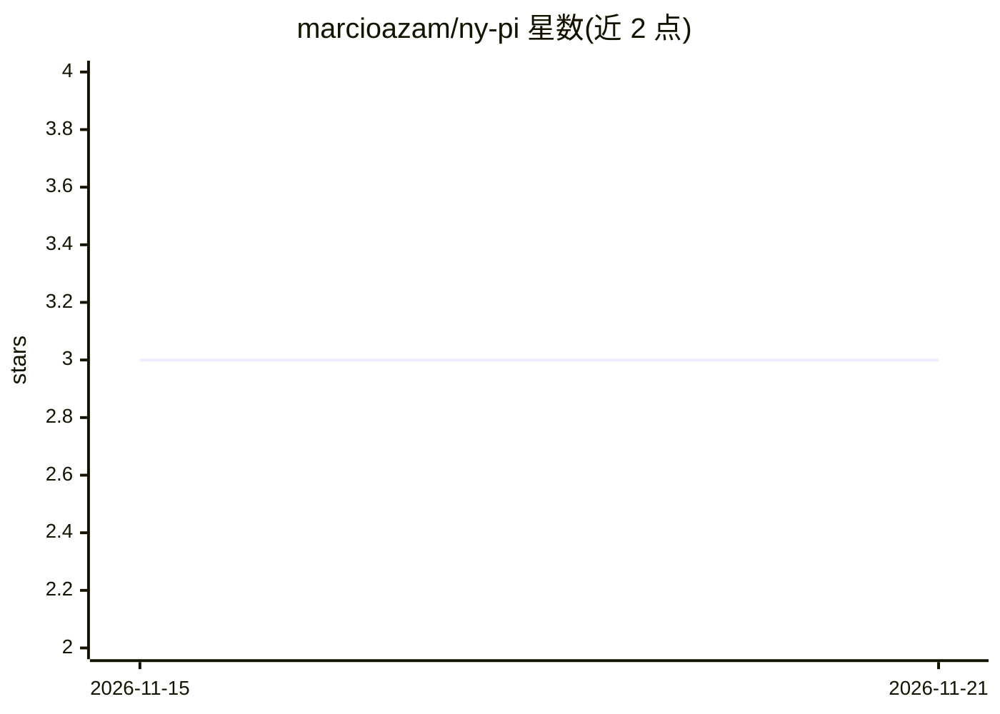

# marcioazam/ny-pi

⭐ 3 · Python · MIT · 推送 2026-11-20 · [GitHub](https://github.com/marcioazam/ny-pi) · 个人维护

**为 pi 编码代理提供扩展/hook/技能并做基准测量的工具集**

围绕 pi 编码代理的测量型 harness，包含包装器、扩展、hooks、技能、agents 与安装器；对每个 pull request 以固定基线做基准门控。与 Claude Code 及不带 harness 的 pi 在同一模型、同一任务集（42 任务、12 个多文件任务、Terminal-Bench 2.0）上测量成本与解题数，数据存于 docs/bench/ 并注明样本量与置信区间；README 规定同时报告胜出与落后项。已知限制包括 guard hook 无法识别部分子 shell 包装的危险命令、墙钟时间未纳入门控。

## 筛选速览

| 维度 | 判定 | 备注 |
|---|---|---|
| AI 角色 | `ai-ecosystem` | LLM/agent 周边工具 |
| 许可风险 | `permissive` | MIT |
| 部署形态 | `None` |  |
| 模型依赖 | — | README 未给出锁定关系 |
| 硬件要求 | — | 无带数字的原话,不猜 |
| 安装摩擦 | `low` | 无编译、无系统依赖或容器化 |
| 成熟度 | — | 结构信号不足 |

## 能力要点

- 每个 PR 与冻结基线进行基准门控对比
- 同模型同任务下与 Claude Code 和 plain pi 的成本/解题数测量，含区间与样本量
- 提供 wrapper、extensions、hooks、skills、agents 与安装器
- README 规则要求胜败并陈、未测即声明未测

## 适用场景

- 为 pi 编码代理增加扩展、hooks 与技能并在受测配置下运行
- 在提交前用基准门控检查 harness 改动的影响
- 查询 pi 与 Claude Code 在同一任务集上的成本与解题数测量数据

## 场景标签

`编码 Agent` `模型评测` · 领域:编码与开发

## 证据(README 行号)

> L3: A harness for the pi coding agent (wrapper, extensions, hooks, skills, agents
> L4: and an installer), measured against Claude Code and plain pi with the same model and the same tasks.
> L26: - Every claim about quality, cost or speed points to a measurement in this repository (raw runs under

## 星数曲线

2026-11-15 3 → 2026-11-21 3（+0）

---
*卡片 v1 · prompt 1.4 · 生成 2026-11-21 · 置信度 mid · 依据 README sha `bc6915672020` · [字段定义](../../DATASET.md)*
