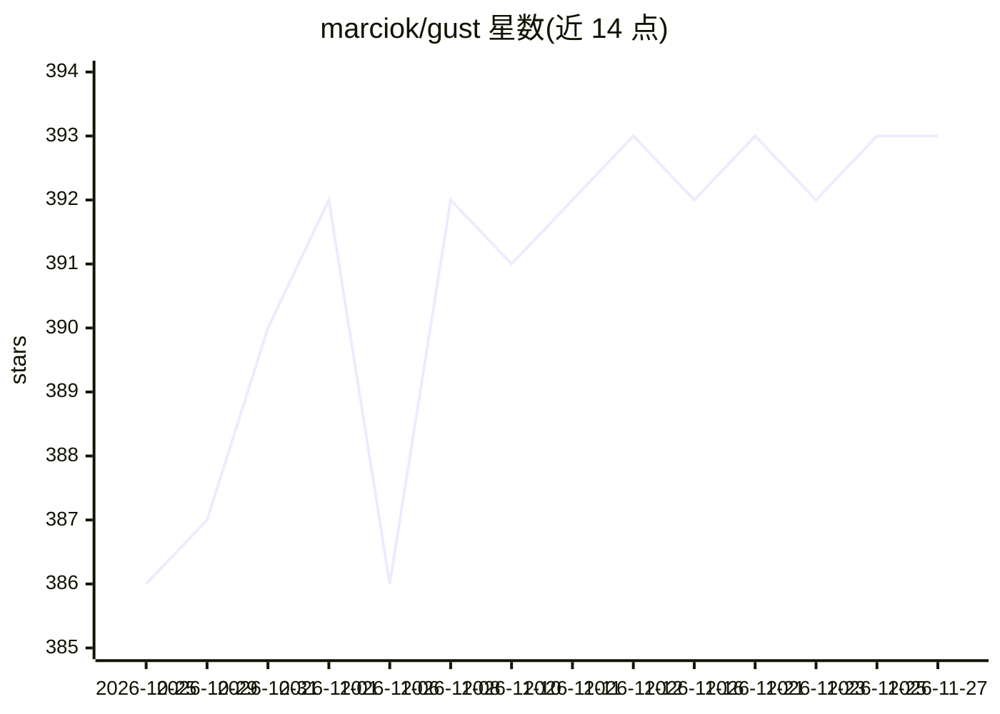

# marciok/gust

⭐ 393 · Elixir · MIT · 推送 2026-11-25 · [GitHub](https://github.com/marciok/gust) · 个人维护

**基于 Erlang VM 的 DAG 工作流编排引擎，支持 agent 接入**

用 Elixir 编写、构建于 Erlang VM 上的任务编排系统，用户在 dags/ 目录保存 DAG 文件后由系统加载，通过 Web UI 手动触发或按 schedule 定时运行；支持 Elixir、Python、shell 三种工作流写法。核心机制包括自动重试与退避、中断恢复、手动任务控制、并发限制、跨节点分发、加密密钥与运行保留。安装需本机具备 Elixir 与 Docker，另有编码 agent 引导文档的安装方式。

## 筛选速览

| 维度 | 判定 | 备注 |
|---|---|---|
| AI 角色 | `ai-enhanced` | 去掉 AI 部分产品仍成立 |
| 许可风险 | `permissive` | MIT |
| 部署形态 | `None` |  |
| 模型依赖 | — | README 未给出锁定关系 |
| 硬件要求 | — | 无带数字的原话,不猜 |
| 安装摩擦 | `low` | 无编译、无系统依赖或容器化 |
| 成熟度 | — | 结构信号不足 |

## 能力要点

- 支持 schedules、并行任务、条件与外部事件暂停的 DAG 定义
- 自动重试、中断恢复与手动任务控制
- Web UI 实时仪表盘：日志、结果、堆栈与进程健康检查
- 通过 HTTP、CLI、MCP 连接应用与 agent

## 适用场景

- 编排有依赖关系的定时/并行任务
- 用 Elixir、Python 或 shell 编写工作流并集中监控
- 多节点分布式执行任务并控制并发

## 场景标签

`工作流自动化` · 领域:效率与自动化

## 证据(README 行号)

> L3: A task orchestration system designed to be efficient, fast, developer-friendly, and easy to scale. Built on the Erla
> L80: |Use your existing tools|Write Elixir, Python, or shell workflows; connect applications and agents through HTTP, CL
> L93:  - MCP Server

## 星数曲线

2026-10-25 386 → 2026-11-27 393（+7）

---
*卡片 v1 · prompt 1.4 · 生成 2026-11-26 · 置信度 mid · 依据 README sha `3658579ed26b` · [字段定义](../../DATASET.md)*
